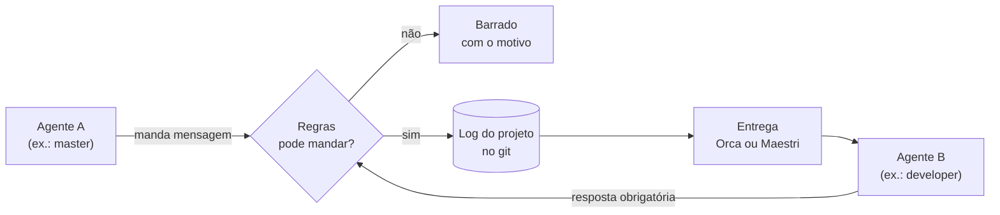
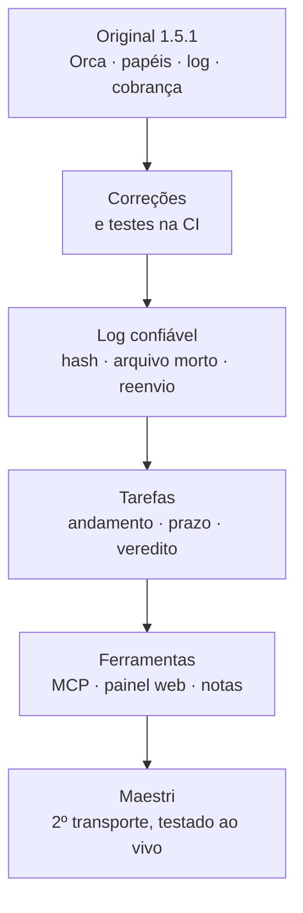

# agent-board

**Um time de agentes de IA que conversa com regras.** Master, developers e pesquisadores, cada um no seu terminal (Orca ou Maestri), trocando pedidos e respostas que ficam registrados, são conferidos e nunca ficam sem resposta.

> Fork de [BFLabsAI/agent-board](https://github.com/BFLabsAI/agent-board), evoluído com suporte ao Maestri, protocolo de tarefas, painel web, servidor MCP e mais. Veja [o que mudou](#o-que-mudou-desde-o-fork).

---

## Como funciona, em uma imagem

Cada agente roda num terminal. Quando um fala com outro, a mensagem passa pelo agent-board, que funciona como um **carteiro com regras**:



| Garantia | Na prática |
|---|---|
| **Um canal só** | Agente fala com agente só pelo agent-board; atalhos são barrados. |
| **Remetente provado** | A identidade é o terminal cadastrado, não o nome que o agente diz ter. |
| **Tudo no log** | Cada mensagem vira uma linha em `docs/agent-board/comunicacoes.jsonl`, no git. |
| **Resposta obrigatória** | O agente não encerra o turno devendo resposta. |
| **Papéis** | **master** coordena e revisa · **manager** é o developer · **researcher** pesquisa. |

Quer entender melhor? [Como funciona](docs/conceitos/como-funciona.md) · [Papéis e mensagens](docs/conceitos/papeis-e-mensagens.md) · [Regras](docs/conceitos/regras.md)

---

## Escolha seu caminho

| | Você usa… | Comece aqui |
|---|---|---|
| 🖥️ | **Orca** — terminais do Orca, mensagens pelo correio dele | [Guia do Orca](docs/guias/orca/README.md) |
| 🎨 | **Maestri** — terminais num canvas, ligados por cordas | [Guia do Maestri](docs/guias/maestri/README.md) |

Os dois guias têm os mesmos 4 passos: **instalar → montar o time → dia a dia → problemas**. As regras, o log e os comandos são os mesmos; muda só como a mensagem chega.

---

## Setup geral (uma vez por máquina)

Instale na máquina onde os agentes rodam (com Orca via SSH, é o servidor remoto).

**Precisa de:** Python 3.8+ · git · Claude Code e/ou Oh My Pi · a CLI `orca` ou `maestri` · Linux ou macOS (Windows: WSL).

**1. Baixe a skill numa pasta fixa** (os hooks apontam para ela):

```bash
git clone https://github.com/davioliveeira/agent-board.git ~/.agents/skills/agent-board
mkdir -p ~/.claude/skills && ln -s ../../.agents/skills/agent-board ~/.claude/skills/agent-board
```

**2. Ligue os hooks** (pode rodar de novo quando quiser; faz backup do seu settings):

```bash
S=~/.agents/skills/agent-board/scripts
bash $S/install.sh
```

**3. Confira que está tudo certo:**

```bash
for t in $S/test_*.py; do python3 "$t" || break; done   # todos os testes passam
```

No Claude Code, `/hooks` deve mostrar as entradas `agent-board`.

✅ **Pronto.** Enquanto ninguém for cadastrado, nada muda no seu dia a dia. Agora siga o guia do [Orca](docs/guias/orca/README.md) ou do [Maestri](docs/guias/maestri/README.md) para montar o time.

---

## O que mudou desde o fork

A versão original (1.5.1) fazia o essencial no Orca. Daqui até a **1.9.3**:



| Evolução | O que ganhou |
|---|---|
| **Maestri** | O mesmo time num canvas: `board.py send`, cadastro pelo próprio agente, cordas criadas pela política. |
| **Tarefas** | `andamento` para trabalho longo, `--prazo` com vigilância, entrega com veredito aprovado/rejeitado, quadro de tarefas. |
| **Regras sob medida** | Quem pede a quem, limite de pedidos, alerta de ping-pong — e `simular` antes de ligar. |
| **Log confiável** | Cadeia de hash que acusa adulteração, arquivo morto, reenvio de mensagem perdida. |
| **Ferramentas** | Servidor MCP (sem erro de aspas), painel web local, notas e decisões do time, resumo do período. |
| **Qualidade** | 231 testes em 8 suítes (inclusive os links da documentação), CI em Python 3.8 e 3.12, código em módulos pequenos, 7 ADRs. |

Detalhes em linguagem simples: [MELHORIAS.md](docs/MELHORIAS.md) · Histórico completo: [CHANGELOG.md](CHANGELOG.md) · Decisões: [docs/adr/](docs/adr/)

---

## Mapa da documentação

| Quero… | Vá para |
|---|---|
| Entender a ideia | [docs/conceitos/](docs/conceitos/como-funciona.md) |
| Fazer, passo a passo | [Orca](docs/guias/orca/README.md) · [Maestri](docs/guias/maestri/README.md) |
| Os agentes usarem ferramentas em vez de comandos (MCP) | [Guia do MCP](docs/guias/mcp.md) |
| Consultar um comando ou config | [Comandos](docs/referencia/comandos.md) · [Config](docs/referencia/config.md) · [Arquivos e estado](docs/referencia/arquivos-e-estado.md) · [Hooks e limites](docs/referencia/hooks-e-limites.md) |
| Acompanhar o time numa tela | [Painel web](docs/userguide/painel.md) |
| Saber as regras que todo agente segue | [Contrato do time](templates/CONTRATO.md) |
| Procedimento do master (para o agente) | [SKILL.md](SKILL.md) |
| Contribuir com a documentação | [Guia de estilo](docs/ESTILO.md) |

---

## Licença

MIT. Veja [LICENSE](LICENSE).
