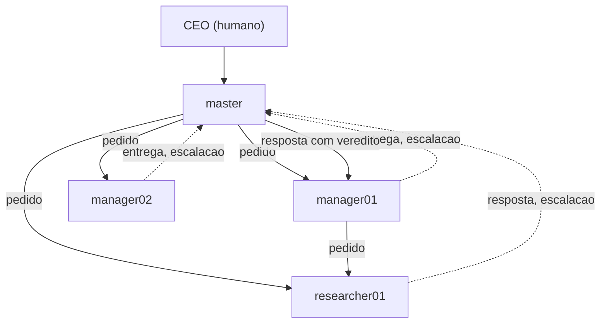
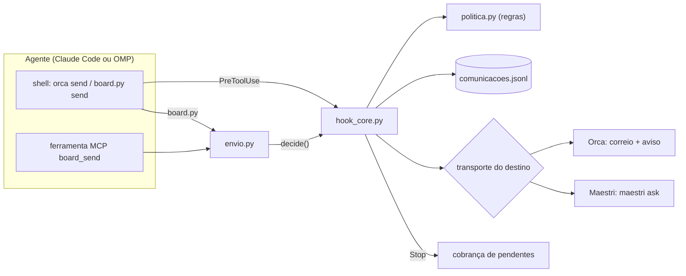
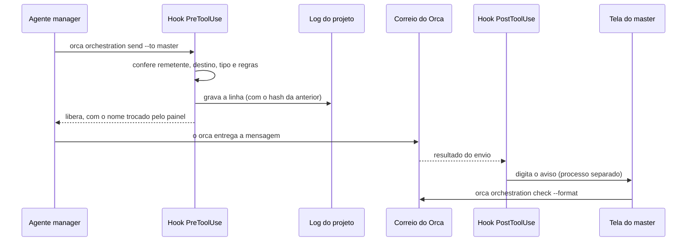
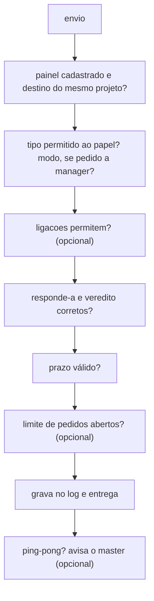
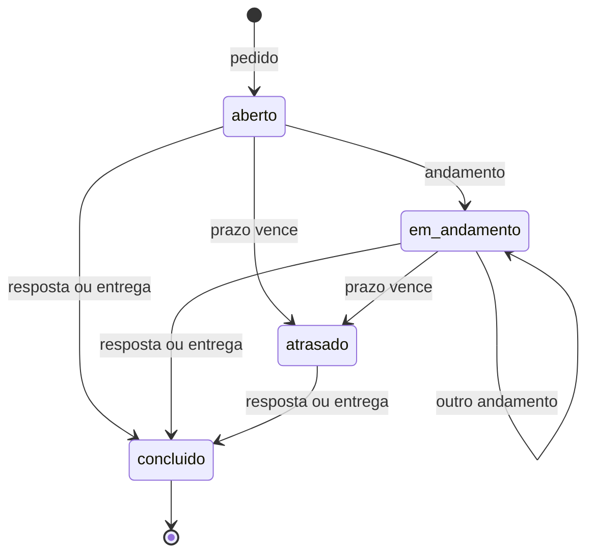
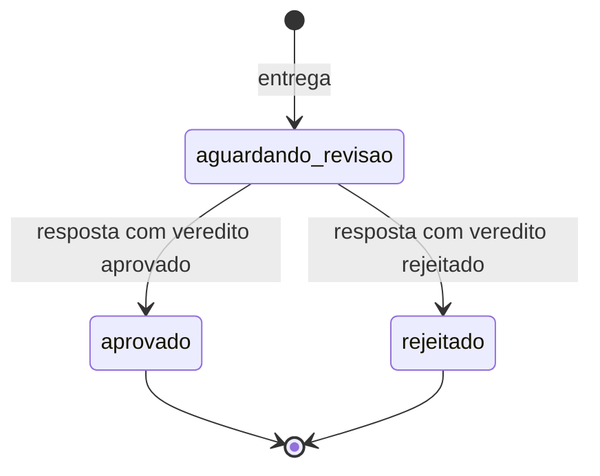

# agent-board: base de conhecimento do produto

> **Para quem é:** o CEO. Serve para entender, explicar, vender e decidir sobre o agent-board.
> **Versão descrita:** `1.11.0`, a do release do painel v2 (o arquivo [`scripts/VERSION`](../scripts/VERSION) recebe o número no bump do release). A skill instalada nesta VPS ainda é a `1.10.2`, até a atualização do clone. O **painel v2** (a nova interface web) está integrado na branch `feat/painel-v2` com as sete telas prontas.
> **Fonte de verdade:** o código em `scripts/`. Quando uma doc discorda do código, vale o código, e a diferença está na seção [14. Divergências encontradas](#14-divergências-encontradas).
> **Estilo:** frases curtas e muitas tabelas, como em [ESTILO.md](ESTILO.md). Este arquivo passa do limite de tamanho do guia de estilo de propósito: é uma base de conhecimento, não um guia de passo a passo.

## Índice

| # | Seção | Para que serve |
|---|---|---|
| 1 | [Resumo e "em 1 minuto"](#1-resumo-e-em-1-minuto) | Explicar o produto em 30 segundos |
| 2 | [Problema, público e decisão](#2-problema-que-resolve-e-para-quem) | Vender e decidir |
| 3 | [Conceito e glossário](#3-conceito) | Falar a língua do produto |
| 4 | [Como funciona](#4-como-funciona) | Entender a engrenagem |
| 5 | [Protocolo de mensagens e tarefas](#5-protocolo-de-mensagens-e-tarefas) | Saber o que cada tipo faz |
| 6 | [Features completas](#6-features-completas) | Inventário por área |
| 7 | [Compatibilidade](#7-compatibilidade) | Saber onde roda e o que não roda |
| 8 | [Instalação e setup](#8-instalação-e-setup) | Colocar para funcionar |
| 9 | [Segurança e limites](#9-segurança-e-limites) | Saber o que protege e o que não |
| 10 | [Decisões de arquitetura (ADRs)](#10-decisões-de-arquitetura-adrs) | Entender o porquê |
| 11 | [Histórico, uso real e roadmap](#11-histórico-de-versões-uso-real-e-roadmap) | Saber de onde veio e para onde vai |
| 12 | [FAQ e troubleshooting](#12-faq-e-troubleshooting) | Resolver problemas comuns |
| 13 | [Mapa de arquivos](#13-mapa-de-arquivos) | Achar cada coisa |
| 14 | [Divergências encontradas](#14-divergências-encontradas) | Ver onde a doc e o código discordam |

---

## 1. Resumo e "em 1 minuto"

O agent-board é um **carteiro com regras** para times de agentes de IA. Cada agente (Claude Code, Oh My Pi e, sem trava automática, outros) roda num terminal próprio, no Orca ou no Maestri. Quando um agente fala com outro, a mensagem passa pelo agent-board: ele confere se pode, grava numa linha do log do projeto (no git), entrega pelo correio do terminal de destino e **cobra a resposta**. Ninguém encerra o turno devendo resposta. O CEO enxerga o que aconteceu pelo log, por resumos e por um painel web local.

É uma skill de código aberto (MIT), feita só com a biblioteca padrão do Python, que nasceu como [BFLabsAI/agent-board](https://github.com/BFLabsAI/agent-board) (versão 1.5.1) e foi muito evoluída em um fork.

### Em 1 minuto

| Pergunta | Resposta |
|---|---|
| O que é? | Camada de regras, registro e cobrança sobre a comunicação entre agentes de IA. |
| O que ele **não** é? | Não é um agente, não tem correio próprio e não executa trabalho. Usa o correio do Orca ou o canvas do Maestri. |
| Quem fala com quem? | **master** (coordena e revisa), **manager** (o developer), **researcher** (pesquisa, só lê). O CEO fica por cima do master. |
| O que garante? | Um canal só, remetente conferido pelo terminal cadastrado, tudo no log, resposta obrigatória, projetos isolados, log com selo de integridade. |
| Como o CEO acompanha? | `painel.py resumo` ("o que houve enquanto eu estava fora"), `painel.py tarefas`, o painel web e as notas e decisões do time. |
| Onde roda? | Linux (testado em CI e nesta VPS) e macOS (documentado, sem CI). Windows só por WSL, não testado. Python 3.8 ou mais novo. |
| Quanto custa em dependências? | Zero pacotes Python. Precisa de `git`, `bash` e da CLI `orca` ou `maestri`. |
| Em que estágio está? | Versão 1.11.0, com 324 testes Python em 10 suítes e 159 testes do front (Vitest). Em uso real nesta VPS desde 2026-10-07. Painel v2 pronto, com sete telas. |
| Qual o maior limite? | A trava automática só existe para Claude Code e OMP. Outros harnesses seguem o contrato por disciplina. |

---

## 2. Problema que resolve e para quem

### 2.1 O problema

Vários agentes de IA trabalhando juntos no mesmo projeto têm quatro defeitos naturais.

| Sem o agent-board | Consequência |
|---|---|
| Cada agente fala com o outro pelo canal que quiser | Conversa sem registro. Ninguém sabe o que foi combinado. |
| Qualquer agente pode dizer que é outro | Ordem falsa, sem rastro. |
| Pedido sem resposta fica no ar | Trabalho perdido em silêncio. |
| O humano não vê o que está acontecendo | O CEO descobre o problema tarde. |

### 2.2 Quem usa e o que ganha

| Papel | Quem é | O que ganha com o agent-board |
|---|---|---|
| **CEO / humano** | Dono do projeto. Decide, confirma cadastros, aprova entregas grandes. | Visibilidade (resumo, quadro de tarefas, painel web), controle (ele confirma quem é quem) e um log que prova o que foi combinado. |
| **Master** | Agente que coordena. Único que fala com o CEO e cadastra painéis. Faz merge e deploy. | Um quadro de tarefas, prazos vigiados, entregas com veredito e alertas de ping-pong. É quem usa a [skill](../SKILL.md). |
| **Manager** | Agente developer. Implementa na própria branch ou worktree e entrega. | Regras claras de como pedir, andar e entregar. Recebe o comando de resposta pronto no rodapé de cada pedido. |
| **Researcher** | Agente que só lê: pesquisa, análise, documentação. | Um canal oficial para devolver resultado, sem poder pedir trabalho a ninguém. |

### 2.3 Argumentos de venda (todos com base no repositório)

| Argumento | Base |
|---|---|
| **Auditável.** Cada mensagem vira uma linha em `docs/agent-board/comunicacoes.jsonl`, no git, com cadeia de hash que acusa edição no meio do log. | [ADR-0002](adr/0002-cadeia-de-hash-no-log.md), `painel.py verificar` |
| **Nada se perde.** O agente é segurado até 3 vezes ao tentar encerrar com resposta pendente. | `decide_stop` em [`hook_core.py`](../scripts/hook_core.py) |
| **Sem dependência.** Só biblioteca padrão do Python. Nenhum `pip install`. | [`MELHORIAS.md`](MELHORIAS.md), o código não importa nada de fora |
| **Dois transportes, um conjunto de regras.** Orca ou Maestri, mesma política e mesmo log. | [ADR-0006](adr/0006-maestri-como-transporte.md) |
| **Testado.** 324 testes em 10 suítes (mais 159 do front), incluindo CLI falsa do Maestri, adaptador do OMP rodando de verdade no `bun` e conferência dos links da documentação. | Seção [7.6](#76-testes-e-ci) |
| **Em uso real.** 557 mensagens em 13 dias num projeto desta VPS (seção [11.3](#113-uso-real-nesta-vps)). | Log agregado |
| **Governança configurável.** Quem pede a quem, limite de pedidos abertos, prazo padrão e alerta de ping-pong, com `simular` para testar antes de ligar. | [Regras](conceitos/regras.md) |

### 2.4 Quando **não** é a ferramenta certa

| Situação | Por quê |
|---|---|
| Time misto (parte no Orca, parte no Maestri) | Não é suportado. O hook barra o `orca` para destino no Maestri. |
| Agente que não seja Claude Code nem OMP e que você precise **obrigar** | Sem hook, não há trava nem cobrança. Só disciplina de contrato. |
| Segurança contra um agente **malicioso** | O agente roda com o mesmo usuário do hook. A proteção é de processo, não de isolamento. Veja [9](#9-segurança-e-limites). |
| Duas máquinas editando o mesmo checkout | A trava vale por máquina. |
| Trabalhar sem terminal Orca ou Maestri | O produto depende do correio ou do canvas deles. |

### 2.5 Perguntas para decidir

| Pergunta | Se a resposta é "sim" |
|---|---|
| Mais de um agente trabalha no mesmo projeto? | Há ganho de registro e cobrança. |
| Os agentes são Claude Code ou OMP? | Você tem a trava completa. |
| Você precisa provar depois o que foi pedido e entregue? | O log com hash resolve. |
| Você aceita que o agent-board só proteja contra descuido, não contra malícia? | O modelo de ameaça bate. |

---

## 3. Conceito

### 3.1 O modelo em uma tela

Um time de agentes de IA, cada um num terminal diferente, trocando mensagens com regras. O CEO coordena pelo master.



Setas cheias levam trabalho. Setas pontilhadas levam o retorno ao master. Tudo passa pelo agent-board e vira linha no log.

### 3.2 Os cinco pilares

| Pilar | O que significa | Como é garantido |
|---|---|---|
| **Um canal só** | Agente fala com agente só pelo agent-board. | O hook barra `maestri ask` direto, `SendMessage`, `orca orchestration reply` e `ask`. |
| **Remetente provado** | Quem manda é o terminal cadastrado, não o nome que diz ter. | Identidade vem de `$ORCA_TERMINAL_HANDLE` ou `$MAESTRI_TERMINAL_ID`, procurada em `paineis.json`. Há um ponto fraco no `board.py` (seção [9.4](#94-o-que-não-protege)). |
| **Tudo no log** | Cada mensagem vira uma linha no git. | `registro.gravar_log`, antes da entrega. |
| **Resposta obrigatória** | Não se encerra o turno devendo resposta. | Hook `Stop`. |
| **Papéis** | Cada papel só envia certos tipos e só pede a certos papéis. | `politica.py` + `agent-board.json`. |

### 3.3 Painéis

Cada agente roda num **painel**. A identidade do painel muda conforme o transporte.

| | Orca | Maestri |
|---|---|---|
| Identidade | `$ORCA_TERMINAL_HANDLE` (`term_…`) | `maestri:<$MAESTRI_TERMINAL_ID>` |
| Como o agente envia | `orca orchestration send`, `board.py send` ou `board_send` | `board.py send` ou `board_send` |
| Como a mensagem chega | Correio do Orca, mais um aviso de uma linha digitado na tela | Mensagem inteira digitada no terminal (`maestri ask`) |
| Quem fala com quem | Qualquer painel cadastrado do projeto | Só terminais ligados por **corda** no canvas |
| Cadastro | O master lista (`painel.py listar`) e cadastra | O agente pede (`solicitar`), o master confirma e cadastra |
| Quando o painel muda | O ID muda ao reabrir o painel: recadastrar | O ID e o nome no canvas mudam ao recriar: `solicitar` de novo |

### 3.4 Contrato

O **contrato** é o arquivo `docs/agent-board/CONTRATO.md` de cada projeto. Todo agente o lê. Ele sai **escrito só para a interface escolhida** (Orca ou Maestri), a partir de um único [template](../templates/CONTRATO.md) com marcadores ([ADR-0008](adr/0008-interface-escolhida-no-setup-e-contrato-adaptado.md)). As duas versões geradas têm 137 e 141 linhas, contra 156 do contrato misto (números da ADR, na data dela).

### 3.5 Glossário

| Termo | Significado |
|---|---|
| **agent-board** | O produto: a skill, os hooks, o MCP, o `painel.py` e o painel web. |
| **Harness** | O programa que hospeda o agente: Claude Code, OMP, Codex etc. |
| **Painel** | O terminal de um agente. Tem um ID (handle). |
| **Handle** | O ID do painel. Orca: `term_…`. Maestri: `maestri:<id>`. |
| **Cadastro** | `~/.agent-hooks/agent-board/paineis.json`: handle → projeto, agente, papel. Fora do git. |
| **Master / manager / researcher** | Os três papéis. Pode haver vários managers e researchers. |
| **CEO** | O humano responsável. Confirma cadastros e decide. |
| **Transporte / interface** | Orca ou Maestri. Escolhido por projeto no `init`. |
| **Orca** | App de terminais com correio entre painéis (`orca orchestration`). |
| **Orca server** | Modo recomendado: `orca serve` no servidor. O correio e os terminais ficam nele. |
| **Relay SSH** | Modo antigo do Orca: a CLI `orca` fala com o app no computador do usuário. |
| **Maestri** | App de canvas onde cada agente é um terminal e as ligações são cordas. |
| **Corda** | Ligação entre dois terminais no canvas do Maestri. Sem corda, o `maestri ask` falha. |
| **Modo Maestro** | Interruptor do Maestri por terminal. Só ele recruta agentes, cria cordas e routines. |
| **Floor** | Um git worktree no Maestri. |
| **Hook** | Trava automática do harness. Roda antes ou depois de uma ferramenta e pode barrar. |
| **PreToolUse / PostToolUse / Stop** | Os três eventos de hook usados. Antes da ferramenta, depois dela e ao encerrar o turno. |
| **Política** | O conjunto de regras de envio em `politica.py`, sem I/O. |
| **Contrato** | `CONTRATO.md`: as regras que o agente lê. |
| **Log** | `docs/agent-board/comunicacoes.jsonl`: uma linha por evento, no git. |
| **Cadeia de hash** | Cada linha leva o hash da anterior (`prev`). Edição no meio é detectável. |
| **Arquivo morto** | `docs/agent-board/arquivo/AAAA-MM.jsonl`: conversas fechadas e antigas. |
| **`merge=union`** | Regra do git que junta linhas de dois ramos sem conflito. |
| **Pedido** | Mensagem que pede um trabalho. |
| **Andamento** | Progresso de um pedido longo. Para a cobrança sem fechar o pedido. |
| **Entrega** | Trabalho pronto para revisão. Só vai ao master. |
| **Veredito** | `aprovado` ou `rejeitado`, dado pelo master na resposta a uma entrega. |
| **Escalação** | Algo travou ou precisa de decisão. Só vai ao master. |
| **Prazo** | Hora-limite de um pedido (`30m`, `2h`, `1d`). |
| **Atrasado** | Pedido com prazo vencido e sem resposta. Marcado pelo `vigiar`. |
| **Ping-pong** | Conversa demais entre o mesmo par sem entrega no meio. Só avisa. |
| **Subagent** | Ajudante interno do harness. Não fala com o time. |
| **Cobrança** | O que o hook `Stop` faz: segura o agente que tenta encerrar com resposta pendente. |
| **Fail-closed** | Se o hook quebra num comando do time, o comando é barrado. |
| **MCP** | Protocolo de ferramentas. O servidor `agent-board` expõe 5 ferramentas `board_*`. |
| **TOON** | Formato de tabela compacto, usado só na **saída** para agentes. Gasta menos tokens que JSON. |
| **SSE** | *Server-Sent Events*. O servidor do painel empurra eventos para a página (painel v2). |
| **SPA** | Aplicação de página única. O painel v2 é uma SPA em React. |
| **ADR** | Registro de decisão de arquitetura, em `docs/adr/`. |
| **Runtime (código)** | Sufixo do nome do agente: `cc` Claude Code, `omp` Oh My Pi, `cx` Codex, `agy` Antigravity, `oc` OpenCode, `hr` Hermes. |
| **`AGENT_BOARD_HOME`** | Pasta do estado (padrão `~/.agent-hooks/agent-board`). |

---

## 4. Como funciona

### 4.1 Arquitetura

O diagrama mostra as peças e por onde a mensagem passa. A **política** mora num lugar só, e os três caminhos de envio chegam nela.



| Peça | Papel | Arquivo |
|---|---|---|
| **Hook** | Ponto de entrada. Lê o evento, aplica a política antes do envio, avisa depois e cobra no Stop. | [`hook_core.py`](../scripts/hook_core.py) |
| **Política** | Regras de envio como função pura (`validar_envio`). Usada pelo hook, pelo MCP e pelo `simular`. | [`politica.py`](../scripts/politica.py) |
| **Registro** | Escreve, lê, verifica e arquiva o log. Só ele escreve no log. | [`registro.py`](../scripts/registro.py) |
| **Envio** | Entrega pelo transporte do destino. Serve ao `board.py` e ao MCP. | [`envio.py`](../scripts/envio.py) |
| **Avisos** | Aviso digitado na tela do destino, em processo separado. | [`avisos.py`](../scripts/avisos.py) |
| **Notificar** | Webhook, comentário no GitHub e status do floor, em processo separado. | [`notificar.py`](../scripts/notificar.py) |
| **Proteção** | Detecta escrita à mão no log e no cadastro. | [`protecao.py`](../scripts/protecao.py) |
| **Base** | Caminhos, cadastro, config, identidade, trava, busca das CLIs. | [`base.py`](../scripts/base.py) |
| **Adaptador OMP** | Traduz os eventos do OMP para o mesmo core. | [`omp-agent-board.ts`](../scripts/omp-agent-board.ts) |

### 4.2 Quem aplica as regras

| Caminho do envio | Quem confere | Observação |
|---|---|---|
| `orca orchestration send` no shell | O **hook** no `PreToolUse` | Vale no Claude Code e no OMP |
| `board.py send` | `envio.py` chama o `hook_core.decide()` antes e depois de entregar | O hook do shell só barra subagent aqui |
| `board_send` (MCP) | `envio.py`, igual ao `board.py` | O hook do MCP só barra subagent ([ADR-0004](adr/0004-servidor-mcp-reusa-a-politica-do-hook.md)) |

Uma regra nova entra em `politica.py` e vale ao mesmo tempo para os três caminhos e para o `simular`.

### 4.3 O caminho de uma mensagem, do envio ao aviso

O diagrama mostra um manager entregando ao master no Orca, pelo shell.



Passo a passo, no código:

| # | O que acontece | Onde |
|---|---|---|
| 1 | O hook lê o comando, exige que o `orca` esteja **sozinho** (sem `&&`, `;`, `\|`, redirecionamento, crase ou `$( )`). | `separar()` |
| 2 | Resolve o destino: nome do time, nome curto (`manager01-cc`), `term_…` ou `papel:<papel>` (o menos ocupado). | `pre_send`, `rotear_por_papel` |
| 3 | Barra se for subagent, para si mesmo, de outro projeto ou para destino no Maestri. | `pre_send` |
| 4 | Roda `validar_envio` (papel, ligações, `--responde-a`, veredito, prazo, limite). | `politica.py` |
| 5 | Gera o id `c-AAAAMMDD-HHMMSS-xxxx` e grava **uma linha no log antes da entrega**. | `gravar_log` |
| 6 | Troca o nome pelo ID do painel, converte o tipo para o do Orca (`pedido` vira `handoff`, os demais `status`), põe o id e o tipo no assunto e acrescenta um **rodapé com o comando de resposta pronto**. | `pre_send` |
| 7 | Guarda o comando traduzido por 7 dias (para o `reenviar`) e um estado pendente para o pós-envio. | `guardar_envio`, `guardar_pendente` |
| 8 | Se o ping-pong passou do limite, avisa o master (uma vez por par por janela). | `alertar_ping_pong` |
| 9 | O Orca entrega. | `orca` |
| 10 | No `PostToolUse`: se a resposta traz `error`, grava uma linha `falhou` (a mensagem sai da cobrança). Senão, dispara o aviso e as notificações em processos separados. | `post_send` |

No Maestri, o envio passa pelo `envio.py`: o `maestri ask` roda em processo separado. Se falhar em até **3 segundos** (sem corda, nome errado), o log marca `falhou`. Senão, vale como entregue. Não há aviso separado, porque o `ask` já digita a mensagem inteira.

### 4.4 Os hooks

Toda entrada roda `python3 <skill>/scripts/hook_core.py --dialect claude`, com timeout de 10 segundos. O core sempre sai com código 0.

| Evento | Matcher | O que faz |
|---|---|---|
| `PreToolUse` | `Bash` | Confere e traduz `orca orchestration send`. Barra `maestri ask` direto, `orca … reply/ask`, `orca terminal send` e escrita à mão no log e no cadastro. Barra subagent no `board.py`. |
| `PreToolUse` | `Edit\|Write\|MultiEdit\|NotebookEdit` | Barra edição do log e do cadastro. |
| `PreToolUse` | `SendMessage` | Barra `SendMessage` entre agentes do time. |
| `PreToolUse` | `mcp__agent-board__board_send` | Só barra subagent. A regra do envio roda no `envio.py`. |
| `PostToolUse` | `Bash` | Digita o aviso no destino (Orca), marca `falhou` no log se a entrega falhou e dispara as notificações. |
| `Stop` | todos | Cobra mensagens recebidas sem resposta. |

O `Bash` não usa o filtro `if`: o filtro do Claude Code não pega redirecionamentos, como `echo x >> log`. O core descarta em milissegundos o que não interessa.

Como esta VPS registra os hooks (`~/.claude/settings.json`): seis entradas `agent-board`, todas com timeout 10, apontando para `/root/.agents/skills/agent-board/scripts/hook_core.py`. São as quatro de `PreToolUse` da tabela, uma de `PostToolUse` e uma de `Stop`. O servidor MCP está registrado no escopo de usuário e conectado (`claude mcp get agent-board`). O adaptador do OMP está em `~/.omp/agent/hooks/pre/agent-board.ts`.

### 4.5 A política: a ordem das checagens

Toda mensagem passa pelas mesmas checagens, nesta ordem. A primeira que falhar barra o envio, com o motivo e a correção.



| Regra | Efeito | Barra? |
|---|---|---|
| Permissão por papel | O papel só envia os tipos da sua lista. `andamento` passa mesmo fora da lista. | Sim |
| `pode_pedir_a` | `pedido` só vai para papéis da lista do remetente. | Sim |
| `escalacao` e `entrega` | Só vão para o master. | Sim |
| `--modo` | Obrigatório em `pedido` a manager. | Sim |
| `ligacoes` (opcional) | `pedido` e `aviso` só nos pares listados, com direção. | Sim |
| `--responde-a` | Obrigatório em `resposta` e `andamento`. Aponta para mensagem que existe e que você recebeu. | Sim |
| Resposta não se responde | Responder `resposta` ou `andamento` é barrado. | Sim |
| `--veredito` | Obrigatório na resposta a uma `entrega`. Inválido em qualquer outro caso. | Sim |
| `--prazo` | Só em `pedido`. Formato `<n>m`, `<n>h` ou `<n>d`, com n > 0. | Sim |
| `prazo_padrao` (opcional) | Prazo de todo `pedido` sem `--prazo`. | Não |
| `limites.pedidos_abertos_max` (opcional) | Novo `pedido` a quem já tem esse número de pedidos sem resposta. | Sim |
| `limites.ping_pong_*` (opcional) | Mais mensagens que o limite entre o mesmo par na janela, sem `entrega` no meio. | **Não**: avisa o master na tela |

### 4.6 A cadeia de hash

Cada linha nova do log leva `"prev"`: o `sha256` do texto exato da linha anterior, calculado sob a mesma trava que grava ([`registro.py`](../scripts/registro.py), [ADR-0002](adr/0002-cadeia-de-hash-no-log.md)).

| Situação | Resultado do `painel.py verificar` |
|---|---|
| Linha do meio editada ou apagada | `PROBLEMA`: o `prev` da seguinte aponta para um hash que não existe mais. Sai com código 1. |
| Linha **final** apagada | **Não detecta**: não há sucessor. |
| Duas linhas com o mesmo `prev` (resultado normal de `merge=union`) | Conta como bifurcação, não como problema. |
| Mais de uma linha com `prev: ""` | Problema: o log foi apagado e recomeçado. |
| Linha sem `prev` depois do início da cadeia | Problema. |
| Linhas antigas sem `prev`, antes do início da cadeia | Aceitas (migração sem quebra). |
| `arquivar` | Move linhas como **texto cru**: os hashes não mudam. |

Custo: cerca de 75 bytes por linha. A cadeia torna a adulteração **visível**, não impossível.

### 4.7 As travas

| Trava | Onde | Para quê |
|---|---|---|
| Do log de cada projeto | `$AGENT_BOARD_HOME/travas/<sha1 da raiz>.lock` | Quem acrescenta (hook) e quem troca o arquivo (`arquivar`) usam a mesma. Fica **fora** do log para o `os.replace` do arquivamento ser seguro ([ADR-0003](adr/0003-trava-fora-do-log-e-modulos.md)). |
| Do cadastro | `paineis.json.lock` | `cadastrar` e `remover`. |
| Dos estados de aviso e alerta | `avisos-estado.json.lock`, `alertas-estado.json.lock` | Um aviso por destino por janela. |
| Das notas | `travas/` | Duas notas no mesmo tema ao mesmo tempo. |

Implementação: `fcntl.flock` em arquivo `.lock` dedicado, com fallback para `msvcrt` no Windows. A trava vale **por máquina**.

### 4.8 A cobrança de pendentes no Stop

Quando o agente tenta encerrar o turno, o hook `Stop` calcula o que ele recebeu e não respondeu.

| Regra | Detalhe |
|---|---|
| O que é cobrado | Mensagens recebidas, menos `resposta` e `andamento`, sem retorno do agente. |
| O que conta como retorno | **Qualquer** mensagem do agente com `--responde-a` apontando para a original. Inclui `andamento` e `entrega`. |
| Só depois do cadastro atual | Mensagens anteriores ao cadastro do painel não contam. Um recadastro recomeça a conta. |
| Quantas vezes | **3**, para as mesmas pendências. O contador fica em `cobrancas/<painel>.json`. |
| Depois da 3ª | Libera e grava "encerrou com N mensagem(ns) sem resposta" no `avisos.log`. |
| Subagent | Não é cobrado. |
| Mensagem que falhou | Sai da cobrança (linha `falhou`). |
| O que o agente vê | A lista de pendências e o comando pronto para responder a cada remetente. |

### 4.9 O aviso na tela do destino (Orca)

| Regra | Detalhe |
|---|---|
| Quando | Depois de um envio bem-sucedido. |
| Onde | `orca terminal send` na tela do destino, em processo separado. |
| Limite | No máximo **1 por destino a cada 60 s** (`AGENT_BOARD_JANELA_AVISO`). Dentro da janela, espera e só digita se o destino ainda tiver mensagem **não lida**. |
| Diálogo aberto | Não digita se a tela do destino mostra uma pergunta (`Enter to confirm`, `Do you want to`, `(y/n)`…). A mensagem continua no correio. |
| Registro | Tudo vai para o `avisos.log`. |

---

## 5. Protocolo de mensagens e tarefas

### 5.1 Papéis e o que cada um pode enviar (padrão)

| Papel | Pode enviar | Pode fazer `pedido` a |
|---|---|---|
| master | `pedido`, `resposta`, `aviso` | manager, researcher |
| manager | `pedido`, `resposta`, `aviso`, `escalacao`, `entrega`, `andamento` | manager, researcher |
| researcher | `resposta`, `aviso`, `escalacao`, `andamento` | ninguém |

`andamento` vale para qualquer papel, mesmo fora da lista. Os papéis são editáveis em `agent-board.json`. Os **nomes** dos papéis (master, manager, researcher) são fixos no código (`NOME_RE`).

### 5.2 Os seis tipos

| Tipo | Para quê | Vai para | Exige |
|---|---|---|---|
| `pedido` | Pedir um trabalho | Conforme `pode_pedir_a` | `--modo` se for a manager. `--prazo` opcional |
| `resposta` | Responder pergunta, bloqueio ou aviso. **Fecha** a conversa | Quem enviou o original | `--responde-a`. `--veredito` se responde a uma `entrega` |
| `aviso` | Informar, sem pedir trabalho | Qualquer cadastrado do projeto | Uma resposta curta de quem recebe |
| `escalacao` | Algo travou ou precisa de decisão | Só o master | Nada além do básico |
| `entrega` | Trabalho pronto para revisão ou merge | Só o master | `--responde-a` recomendado (é ele que fecha o pedido) |
| `andamento` | Progresso de um pedido longo | Quem fez o pedido | `--responde-a <id do pedido>` |

Todas as mensagens levam `--to`, `--type` e `--subject`. Opcionais: `--body`, `--issues 412,413`.

### 5.3 Modos de um pedido a manager

| Modo | O manager… |
|---|---|
| `executar` | faz o trabalho ele mesmo |
| `orquestrar` | trabalha com subagents, com revisão e QA (skill `/orchestrator`) |

Subagent não fala com ninguém. Só a sessão principal envia mensagens.

### 5.4 O ciclo do pedido

O estado é **sempre derivado do log**, nunca guardado à parte. Aparece em `painel.py tarefas` e no painel web.



| Regra | Detalhe |
|---|---|
| Quem fecha | `resposta` **ou** `entrega` com `--responde-a`, de quem recebeu o pedido ([ADR-0009](adr/0009-entrega-fecha-o-pedido.md)). |
| `andamento` | Para a cobrança do Stop, mas não fecha. Só vale para pedido aberto e vai para quem pediu. |
| Rodapé do pedido a manager | Mostra os dois comandos prontos: `--type entrega` para trabalho feito e `--type resposta` para pergunta ou bloqueio. |
| Resposta a pedido de trabalho | Continua permitida. |

### 5.5 O ciclo da entrega



Entrega **rejeitada não reabre o pedido**. A rejeição mora na entrega, e o manager corrige mandando uma nova `entrega` com o mesmo `--responde-a`. Quem rejeita diz no `--body` o que falta.

### 5.6 Prazos

| Item | Detalhe |
|---|---|
| Formato | `30m`, `2h`, `1d`. Só em `pedido`. |
| Padrão do projeto | `prazo_padrao` no `agent-board.json`. |
| O que o log guarda | O fim do prazo, em ISO com fuso. |
| Quem vigia | `painel.py vigiar` (master), em cron ou `/loop`. No Maestri, `maestri rotina` agenda uma routine. |
| O que o `vigiar` faz | Grava uma linha `atrasado` (uma vez por pedido) e avisa o master na tela. Só olha pedidos **com prazo**. |

Exemplo de agendamento:

```bash
*/10 * * * * python3 ~/.agents/skills/agent-board/scripts/painel.py vigiar --raiz <projeto>
```

### 5.7 Regras opcionais

Cada uma só vale quando a chave existe no `agent-board.json`. Sem ela, nada muda.

| Chave | Efeito |
|---|---|
| `prazo_padrao` | Prazo de todo `pedido` sem `--prazo`. |
| `limites.pedidos_abertos_max` | Barra `pedido` a quem já tem esse número de pedidos abertos. |
| `limites.ping_pong_max` + `ping_pong_janela_min` | Avisa o master (não barra) quando passa do limite entre o mesmo par, sem entrega no meio. |
| `ligacoes` | Pares `[de, para]` (papel ou nome de agente) para `pedido` e `aviso`. `resposta`, `andamento`, `escalacao` e `entrega` ao master sempre passam. |

Antes de ligar, teste contra o histórico real: `painel.py simular --raiz <projeto> --config novo.json`. Ele reexecuta cada mensagem do log contra a config nova e lista o que seria barrado. Sai com 1 se algo seria barrado.

### 5.8 Ping-pong

| Item | Detalhe |
|---|---|
| Conta | Mensagens entre o mesmo par, nos dois sentidos, na janela. Uma `entrega` no meio zera a conta. A mensagem que está saindo entra na conta. |
| O que acontece | Registro no `avisos.log` e aviso na tela do master, **uma vez por par por janela**. Não barra. |
| Por que não barra | Uma conversa longa pode ser legítima. Quem decide é o master ([ADR-0007](adr/0007-protocolo-de-tarefas-e-regras-opcionais.md)). |
| No painel web | Usa 12 mensagens em 10 min quando as chaves não existem, só para mostrar. O hook não avisa nesse caso. |

### 5.9 Regras do contrato que nenhum hook confere

| Regra | Observação |
|---|---|
| Pedido sem resposta em 15 min vira `escalacao` ao master. | Sem automação. Com `--prazo`, o `vigiar` cobre. |
| Comando travado por mais de ~5 min é interrompido e escalado. | Nunca com `pkill` ou `killall`. |
| Nada de mensagem de cortesia. | Só pedido, pergunta que bloqueia, escalação, fim de fase ou entrega. |
| Dois managers nunca dividem a mesma tarefa. | O master separa em frentes. |
| Ninguém delega `main`, deploy, banco de produção ou decisão de produto. | |

### 5.10 Nomes

| Papel | Nome | Exemplo |
|---|---|---|
| master (único) | `<prefixo>-master` | `app-master` |
| manager | `<prefixo>-manager<NN>-<runtime>` | `app-manager01-cc` |
| researcher | `<prefixo>-researcher<NN>-<runtime>` | `app-researcher01-cc` |

O prefixo é só `[a-z0-9]`. `<NN>` tem dois dígitos. O runtime é `[a-z]+`. O nome curto vale (`manager01-cc` vira `app-manager01-cc`). O nome é só endereço: quem prova a identidade é o ID do painel.

### 5.11 Delegar: subagent ou agente do time

| | Subagent interno do harness | Agente do time |
|---|---|---|
| Serve para | Tarefa curta dentro do próprio trabalho | O que precisa de outro papel, outro harness, revisão ou acompanhamento do CEO |
| Aparece no log? | Não | Sim |
| Cobra resposta? | Não | Sim |
| O CEO vê? | Não | Sim |

---

## 6. Features completas

Legenda: **Pronto** = no código e testado na versão 1.11.0.

### 6.1 Comunicação

| Feature | O que faz | Status |
|---|---|---|
| 6 tipos de mensagem | `pedido`, `resposta`, `aviso`, `escalacao`, `entrega`, `andamento` | Pronto |
| Envio pelo shell (Orca) | `orca orchestration send`, conferido e traduzido pelo hook | Pronto |
| Envio por `board.py send` | Mesmas flags, qualquer transporte, `--body-file` (`-` lê da entrada padrão) | Pronto |
| Envio por ferramenta MCP | `board_send` com parâmetros tipados, sem erro de aspas | Pronto |
| Nome curto | `manager01-cc` vira `<prefixo>-manager01-cc` | Pronto |
| Roteamento por papel | `--to papel:researcher` escolhe o agente com menos pedidos abertos (empate: ordem alfabética) | Pronto |
| Rodapé com resposta pronta | Cada mensagem recebida traz o comando exato para responder | Pronto |
| Aviso na tela do destino | Uma linha digitada (Orca), com janela de 60 s e respeito a diálogo aberto | Pronto |
| Entrega no Maestri | `maestri ask` em processo separado; falha em até 3 s vira `falhou` | Pronto |
| Reenvio | `painel.py reenviar <id>` manda de novo ao painel **atual** do destino, no transporte dele | Pronto |
| Ligação com Issues | `--issues 412,413` | Pronto |
| Corpo seguro no MCP e no `board.py` | Crase e `$( )` chegam como texto (nunca passam por shell) | Pronto |
| Notificação externa | Webhook (formato Slack) e comentário em Issue do GitHub | Pronto |

### 6.2 Governança e política

| Feature | O que faz | Status |
|---|---|---|
| Papéis e tipos por papel | Configuráveis em `agent-board.json` | Pronto |
| Quem pede a quem | `pode_pedir_a` e, opcional, `ligacoes` | Pronto |
| Projetos isolados | Agente só fala com cadastrados do mesmo projeto | Pronto |
| Remetente pelo painel | Identidade do terminal, não do nome | Pronto (com ressalva: [9.4](#94-o-que-não-protege)) |
| Subagent barrado | No `orca`, no `board.py` e no `board_send` | Pronto (Claude Code e OMP) |
| Canal único | Barra `maestri ask`, `SendMessage`, `orca … reply/ask` e `orca terminal send` entre agentes | Pronto |
| `orca terminal send` só do master | E só nos painéis do próprio time (ex.: `/clear`) | Pronto |
| Limite de pedidos abertos | `limites.pedidos_abertos_max` | Pronto |
| Prazo padrão | `prazo_padrao` | Pronto |
| Alerta de ping-pong | Avisa o master, não barra | Pronto |
| Simulador de regras | `painel.py simular` contra o log real | Pronto |
| Cobrança no fim do turno | Até 3 vezes, com o comando pronto | Pronto |
| Fail-closed | Se a política quebra num comando do time, o envio é barrado | Pronto |
| Interface por projeto | `init --transporte orca\|maestri` e contrato adaptado | Pronto |
| Cadastro com confirmação | O master lista, o CEO confirma, o master cadastra | Pronto (é regra, não trava de código) |
| Worktree por manager | `cadastrar --worktree` cria `<projeto>-worktrees/<agente>` na branch `ab/<agente>` | Pronto |

### 6.3 Auditoria e memória

| Feature | O que faz | Status |
|---|---|---|
| Log por projeto no git | `comunicacoes.jsonl`, uma linha por evento, com `merge=union` | Pronto |
| Cadeia de hash | `prev` em cada linha; `verificar` acusa edição | Pronto |
| Arquivo morto | `arquivar` move conversas fechadas e antigas para `arquivo/AAAA-MM.jsonl` | Pronto (ressalva em [14](#14-divergências-encontradas)) |
| Histórico | `historico` com filtros por agente e assunto, em TOON ou JSON | Pronto |
| Quadro de tarefas | `tarefas`: estado de cada pedido e entrega | Pronto |
| Resumo do período | `resumo --desde 8h`: contagens, quem espera, entregas, escalações, notas | Pronto (ressalva em [14](#14-divergências-encontradas)) |
| Notas e decisões | `nota` e `notas`, em `docs/agent-board/notas/<tema>.md` | Pronto |
| Branch na entrega | A linha da `entrega` guarda a branch de quem entrega | Pronto |
| `avisos.log` | Avisos, falhas, encerramentos sem resposta, alertas | Pronto |
| Saída em TOON | Economiza tokens no contexto dos agentes | Pronto |

### 6.4 CLI `painel.py` (todos os subcomandos)

`S=~/.agents/skills/agent-board/scripts`. São **20 subcomandos**, mais o `board.py send`. Detalhes de flags em [Comandos](referencia/comandos.md).

| Grupo | Subcomando | O que faz | Quem roda |
|---|---|---|---|
| Cadastro | `init` | Cria `docs/agent-board/` (config, `CONTRATO.md` adaptado, log vazio) e o `merge=union`. Não sobrescreve. | Qualquer um, uma vez por projeto |
| Cadastro | `listar` | Terminais do Orca, cadastro de cada um e pedidos de cadastro do Maestri | Qualquer um |
| Cadastro | `cadastrar` | Cadastra ou recadastra painéis (`--worktree` opcional) | Master (regra) |
| Cadastro | `remover` | Tira painéis do cadastro | Master (regra) |
| Log | `historico` | Últimas mensagens (`--agente`, `--sobre`, `--n`, `--tudo`, `--formato`) | Qualquer um |
| Log | `verificar` | Confere a cadeia de hash. Sai com 1 se achar problema | Qualquer um |
| Log | `arquivar` | Move conversas fechadas e antigas (`--dias 30`) | Master (trava) |
| Log | `reenviar` | Reenvia uma mensagem ao painel atual do destino | Master (trava) |
| Tarefas | `tarefas` | Quadro de pedidos e entregas | Qualquer um |
| Tarefas | `vigiar` | Escala pedidos com prazo vencido | Master (trava) |
| Tarefas | `simular` | Testa uma config nova contra o log | Qualquer um |
| Time | `nota` | Acrescenta nota ou decisão | Qualquer um |
| Time | `notas` | Lista temas, ou as notas de um tema | Qualquer um |
| Time | `resumo` | O que aconteceu no período | Qualquer um |
| Painel web | `servir` | Sobe o painel local em `127.0.0.1:8765` | Qualquer um |
| Maestri | `eu` | Handle, transporte, nome no canvas e cadastro deste terminal | Qualquer um |
| Maestri | `solicitar` | O agente pede o próprio cadastro | O próprio agente, num terminal do Maestri |
| Maestri | `solicitacoes` | Lista os pedidos de cadastro pendentes | Master (regra) |
| Maestri | `maestri conectar` | Mostra ou cria as cordas que a política exige (`--aplicar`) | Master (trava), em modo Maestro |
| Maestri | `maestri rotina` | Mostra ou cria a routine que roda o `vigiar` (`--a-cada 10m`, `--aplicar`) | Master (trava), em modo Maestro |

Legenda de "quem roda": **regra** = o contrato diz que é do master, mas o código não confere. **trava** = o código recusa agente cadastrado que não seja master.

`board.py send` aceita: `--to`, `--type`, `--subject` (obrigatórios) e `--body` ou `--body-file`, `--modo`, `--issues`, `--responde-a`, `--prazo`, `--veredito`. Sai com 1 se barrado ou não entregue.

### 6.5 Servidor MCP (5 ferramentas)

Servidor `agent-board` ([`mcp_server.py`](../scripts/mcp_server.py) e [`mcp_ferramentas.py`](../scripts/mcp_ferramentas.py)): JSON-RPC 2.0 sobre stdio, só biblioteca padrão. Aceita as versões de protocolo `2025-06-18`, `2025-03-26` e `2024-11-05`, e aceita lote. Erro de regra volta como resultado com `isError`, não como erro de protocolo: o agente lê o motivo e corrige.

| Ferramenta | Parâmetros | O que faz |
|---|---|---|
| `board_send` | `para`, `tipo`, `assunto` (obrigatórios); `corpo`, `modo`, `issues` (lista de inteiros), `responde_a`, `prazo`, `veredito` | Envia, com as mesmas regras do hook. Devolve o id `c-…`. |
| `board_inbox` | nenhum | Orca: `orca orchestration check --terminal <painel> --format`. Maestri: as mensagens sem resposta. |
| `board_pendentes` | nenhum | O que você recebeu e não respondeu, em TOON. |
| `board_historico` | `agente`, `sobre`, `n` (padrão 20), `tudo` | O mesmo filtro do `painel.py historico`, em TOON. |
| `board_status` | nenhum | Agente, papel, projeto, raiz, handle, nº de pendentes, versão e agentes do projeto, em TOON. |

Guia: [Mensagens por ferramentas (MCP)](guias/mcp.md). O `install.sh` registra o servidor com `claude mcp add --scope user`.

### 6.6 Painel web v1 (histórico e fallback)

O v1 é uma página HTML única ([`painel_web.html`](../scripts/painel_web.html)) que refaz `GET /api/estado` a cada 5 s. Hoje só roda se não houver o build do v2 em `scripts/painel_web/`. **Só leitura.** Decisão: [ADR-0005](adr/0005-painel-web-local-somente-leitura.md) (a 0010 substitui o "sem build" e o polling).

| Área | Mostra |
|---|---|
| Barra superior | Projeto, versão, selo da cadeia de hash (verde "Cadeia íntegra" ou vermelho "Log adulterado"), período (Hoje, 24 h, 7 dias) e "Atualizado há N s" |
| Indicadores | Mensagens, Pendentes, Atrasados, Entregas aguardando revisão, Tempo médio de resposta (com p90) |
| Mapa do time | Um nó por agente em camadas (master, managers, researchers), cor por papel, bolinha vermelha de pendentes, setas por volume, seta tracejada de ping-pong, nó cinza de painel fechado, branch do worktree |
| Tarefas | Colunas Aberto, Em andamento, Atrasado, Revisão e Concluído; até 6 cartões por coluna |
| Linha do tempo | Até 80 mensagens do período, com busca. Clicar abre a conversa inteira |
| Notas e decisões | Últimas notas, com as decisões destacadas |

O painel **não** mostra o corpo das mensagens, porque ele não fica no log (só o assunto).

### 6.7 Painel web v2

Comando: `painel.py servir [--raiz <projeto>] [--porta 8765]`, em `http://127.0.0.1:8765`. Um servidor atende todos os projetos do cadastro. Guia: [Painel web](userguide/painel.md). Plano (todas as fases concluídas): [`planos/painel-v2.md`](planos/painel-v2.md). Decisão: [ADR-0010](adr/0010-painel-v2-spa-com-build-e-sse.md), aceita pelo CEO em 2026-10-20. Referência visual: o projeto externo `Claude-Code-Agent-Monitor`. Contrato da API: [`painel-api.md`](referencia/painel-api.md). Tokens visuais: [`design-system/MASTER.md`](../design-system/MASTER.md).

#### Decisões

| Item | Decisão |
|---|---|
| Front | React 18, Vite, TypeScript estrito e Tailwind, em `web/`. **O build é commitado** em `scripts/painel_web/`. Quem instala não precisa de Node. |
| Servidor | Continua Python, só biblioteca padrão (`ThreadingHTTPServer`). |
| Tempo real | **SSE** no lugar do polling de 5 s. |
| Projetos | **Multi-projeto**: um servidor atende todos os projetos do cadastro. |
| Telemetria | Nenhuma nova: sem hook novo e sem transcript. Só log, cadastro, `avisos.log`, pendentes, notas e `orca terminal list`. |
| Segurança | Só leitura (outros métodos, inclusive `HEAD` e `OPTIONS`, respondem 405), `127.0.0.1`, checagem de `Host`, CSP sem script inline, conteúdo do log como texto. |
| Fora do escopo | Custo, tokens, ferramenta por ferramenta e subagentes, porque exigiriam telemetria. |

#### Estado de cada parte

| Parte | Estado | Evidência |
|---|---|---|
| API v2 (`/api/*`) e SSE (`/api/stream`) | **Pronta e integrada em `feat/painel-v2`** | `cmd_web.py`, `painel_dados.py`, `painel_stream.py`, `painel_orca.py`; `test_web.py` (54 testes) |
| Casca da SPA | **Pronta** | Sidebar, rotas, tema escuro, seletor de projeto e de período, indicador Live, clientes da API e do SSE, componentes de UI |
| Dashboard, Kanban, Conversas e detalhe, Activity Feed, Analytics, Workflows | **Prontas e integradas** | `web/src/pages/*`; 159 testes Vitest no total |
| Office: Hub, Mapa e Grade, gaveta, Live Logs e modo TV | **Prontos e integrados** | `web/src/pages/Office/` |
| CSP sem script inline; `HEAD` e `OPTIONS` com 405 | **Corrigidos** (divergências 4 e 5) | `cmd_web.py` |
| Build da SPA em `scripts/painel_web/` | Gerado e commitado no release (`npm ci && npm run build`). Sem ele, o servidor cai no painel v1 | `cmd_web._spa()` |
| Playwright de fumaça | **Não feito** (ficou de fora do release) | [`planos/painel-v2.md`](planos/painel-v2.md) |

#### Telas

| Tela | O que mostra |
|---|---|
| **Dashboard** | Oito cartões (agentes trabalhando, pedidos abertos, pendentes, atrasados, aguardando revisão, tempo de resposta com p90, mensagens e entregas), faixa de alertas (cadeia de hash, ping-pong, atrasos), cartões dos agentes (status, tarefa atual, tela do terminal) e atividade recente |
| **Kanban** | Modo **Tarefas** (Atrasado, Aberto, Em andamento, Aguardando revisão, Aprovado, Rejeitado, Concluído) e modo **Agentes** (Trabalhando, Esperando você, Com pendente, Parado, Offline) |
| **Conversas** | Cada pedido com sua thread, duração, participantes, issues e branch. Lista filtrável e ordenável; o detalhe tem o ciclo (pedido, andamento, entrega, revisão) e a timeline |
| **Activity Feed** | Mensagens ao vivo, com filtros (agente, tipo, issue, datas), busca, pausa e agrupamento por conversa. Avisos e cobranças como eventos de sistema ficaram de fora |
| **Analytics** | Últimos 30 dias: heatmap de 371 dias, mensagens e entregas por dia, tipos, horas de pico, tempo de resposta por agente, taxa de rejeição e alertas de ping-pong |
| **Workflows** | Grafo em colunas (Master, Managers e researchers, Issues, Revisão, Resultado), grafo de comunicação e os 10 fluxos mais comuns |
| **Office** | Canvas com zoom e arraste, modo TV e três modos: **Hub** (master numa sala central, managers em mesas, mensagens como pulsos de luz), **Mapa** (organograma, por hierarquia ou por time) e **Grade** (um cartão rico por agente). Clicar abre uma gaveta com a tela do terminal, a tarefa atual e as últimas mensagens; o botão Live Logs abre o feed por cima |

#### Rotas da API v2 (já implementadas)

Todas são `GET`, aceitam `?projeto=` e, quando faz sentido, `?periodo=hoje|24h|7d`.

| Rota | Resposta |
|---|---|
| `/api/projetos` | Projetos do cadastro (cuja raiz tem `agent-board.json`) |
| `/api/estado` | O mesmo JSON do v1, por compatibilidade |
| `/api/resumo` | Cadeia de hash e indicadores (inclui trabalhando, esperando, offline, abertos, entregas do período) |
| `/api/agentes` | Agentes com status, tela, última saída, pendentes, tarefa atual e estatísticas de 14 dias |
| `/api/tarefas` | Tarefas abertas mais as fechadas no período |
| `/api/conversas` e `/api/conversas/<id>` | Threads com filtros (`agente`, `estado`, `q`, `limite`) e o detalhe cronológico |
| `/api/mensagens` | Paginado por `antes`, com filtros (`agente`, `tipo`, `q`) |
| `/api/analytics` | Heatmap de 371 dias, últimos 30 dias, horas, por agente, tipos, alertas |
| `/api/workflows` | Nós, arestas, comunicação, fluxos e KPIs |
| `/api/stream` | SSE (abaixo) |

#### Tempo real (SSE)

O servidor vigia o `comunicacoes.jsonl` (a cada 1 s) e o `orca terminal list` (a cada 2 s, com cache) e só envia o que mudou.

| Evento | Quando |
|---|---|
| `ola` | Ao conectar |
| `mensagem` | Linha nova no log |
| `agente` | Status, tela, pendentes ou tarefa atual mudou |
| `tarefa` | Tarefa nova ou com estado mudado |
| `ping` | A cada 15 s, sem outro evento |

Não há replay: ao reconectar, a página recarrega as rotas REST. Limite de **16 conexões SSE**; a 17ª recebe 503.

#### Status do agente (heurística, isolada e testada)

O status vem do `orca terminal list`: título com *spinner*, saída recente e texto da tela. Cai em `parado` ou `desconhecido` quando não reconhece.

| Status | Quando |
|---|---|
| `trabalhando` | Título com spinner, ou saída do terminal há menos de 10 s |
| `esperando` | A tela pede ação humana (`Do you want`, `[y/n]`, `Allow`, `permission`, `❯ 1.`) |
| `pendente` | O agente tem mensagem sem resposta |
| `parado` | Os demais casos |
| `offline` | O handle não está aberto no Orca |
| `desconhecido` | O Orca não respondeu, ou o agente é do Maestri |

A ordem de checagem no código é: `desconhecido`, `offline`, `esperando`, `trabalhando`, `pendente`, `parado`. O status vem de uma heurística sobre o formato do título e da tela do Orca, que pode mudar ([riscos do plano](planos/painel-v2.md)).

---

## 7. Compatibilidade

### 7.1 Harnesses (o programa que hospeda o agente)

"Trava" quer dizer: o agent-board barra desvios e cobra resposta sozinho. Sem trava, o agente depende do contrato.

| Harness | Trava automática | Evidência | Situação |
|---|---|---|---|
| **Claude Code** | **Sim, completa** | `install.sh` grava os hooks em `~/.claude/settings.json` e registra o MCP. Esta VPS usa. | Suportado e testado |
| **OMP (Oh My Pi, "Pi")** | **Sim, com limites** | Adaptador `omp-agent-board.ts` instalado em `~/.omp/agent/hooks/pre/`. `test_omp.py` (14 testes) roda o adaptador no `bun` com o core real. Conferido no OMP 18.8.6. | Suportado e testado. O hook vê `bash`, `edit`, `write`, `ast_edit`, `eval` e o `board_send` do MCP; o resto passa. O painel trata a identidade `pi` do Orca como `omp` |
| **Codex** | **Não** | Nenhum instalador de hook. O código `cx` existe nos nomes. O guia do Maestri recruta `Codex` com `--preset`. O arquivo [`agents/openai.yaml`](../agents/openai.yaml) é só um manifesto de skill (`allow_implicit_invocation: false`). | Participa do time por disciplina de contrato, com `board.py send`. **MCP não testado** em Codex |
| **Gemini CLI** | **Não** | Não há código de runtime `gemini` nos nomes (a lista é `cc`, `omp`, `cx`, `agy`, `oc`, `hr`). Nenhum instalador. A função `normalize()` do core reconhece nomes de ferramenta como `run_shell_command`, `write_file` e `replace`, mas nada liga isso a um hook. | **Não suportado.** Poderia entrar como membro por contrato, com um código de runtime livre, mas não há teste nem guia |
| **Antigravity (`agy`), OpenCode (`oc`), Hermes (`hr`)** | **Não** | Só os códigos de nome. `SKILL.md`: "Agentes de outro harness (Codex, Hermes etc.) seguem o contrato, mas sem trava automática". | Por disciplina de contrato. MCP não testado em OpenCode |
| **Outro qualquer** | Não | Mesmo caminho | Precisa de terminal Orca ou Maestri e de `board.py send` |

O que um agente **sem trava** perde: o bloqueio de atalhos (`maestri ask` direto, `SendMessage`, escrita no log), o aviso digitado na tela (no Orca), a cobrança no fim do turno e a trava de subagent. O que ele **mantém**: as regras de envio, se usar `board.py send`, e o registro no log.

### 7.2 Transportes

| | Orca (Orca server) | Orca (relay SSH) | Maestri |
|---|---|---|---|
| Situação | **Recomendado** | Suportado, desaconselhado | Suportado |
| Identidade | `$ORCA_TERMINAL_HANDLE` | Idem | `$MAESTRI_TERMINAL_ID` |
| Busca da CLI | `$ORCA_CLI_BIN_DIR/orca` (shim do servidor) | `$ORCA_REMOTE_CLI_BIN_DIR/orca` ou `~/.orca-relay/bin/orca` | `$MAESTRI_CLI`, `maestri` no PATH ou `~/.maestri/bin/maestri` |
| Aviso na tela | Sim, uma linha | Sim | Não: a mensagem inteira é digitada |
| Cadastro | Master lista e cadastra | Idem | Agente pede, master cadastra |
| Condição para falar | Painéis cadastrados no mesmo projeto | Idem | Terminais ligados por corda |
| Reenvio | Sim | Sim | Sim |
| Cuidado | Num terminal do servidor, **não** misturar com o relay SSH: dá "no live pane bound to a Run" | O app precisa estar aberto; se a conexão cair, pode dar timeout | Se um humano digita no terminal do destino, os textos se misturam |
| Testado ao vivo | Sim (esta VPS, 557 mensagens) | Doc | Sim, com Claude Code real (CHANGELOG 1.9.0, 1.9.1 e 1.9.3) |
| MCP | Só coberto por código e testes, não ao vivo (doc do MCP) | Idem | Testado ao vivo |

Ordem de busca do `orca`: `$ORCA_BIN` → `$ORCA_CLI_BIN_DIR/orca` → `$ORCA_REMOTE_CLI_BIN_DIR/orca` → `PATH` → `~/.orca-relay/bin/orca`. Time misto (parte em cada transporte) **não é suportado**.

### 7.3 Sistemas operacionais

| Sistema | Situação | Base |
|---|---|---|
| **Linux** | Suportado | CI em `ubuntu-22.04` e esta VPS (kernel 6.8) |
| **macOS** | Documentado, **sem CI** | README: "Linux ou macOS" |
| **Windows** | **Só por WSL, não testado** | O `install.sh` é bash. A trava tem fallback `msvcrt`, mas nada o testa. O Maestri existe para macOS e Windows ([ADR-0006](adr/0006-maestri-como-transporte.md)) |

### 7.4 Versões de Python

| Versão | Situação |
|---|---|
| **3.8** | Mínima. Testada em CI. `ruff.toml` usa `target-version = "py38"` |
| **3.12** | Testada em CI. 3.12.3 nesta VPS |
| 3.9 a 3.11, 3.13 ou mais novo | Não testadas explicitamente. Em princípio funcionam, por ser só biblioteca padrão, mas não há prova |

O CI usa `ubuntu-22.04` porque o 24.04 não tem Python 3.8 no `setup-python`.

### 7.5 Dependências e requisitos

| Item | Obrigatório? | Para quê |
|---|---|---|
| Python 3.8+ | **Sim** | Todo o código |
| Pacotes Python | **Nenhum** | Só biblioteca padrão |
| `git` | **Sim** | Log versionado, `cadastrar --worktree`, branch na entrega |
| `bash` e `sed` | **Sim** | `install.sh` |
| CLI `orca` **ou** `maestri` | **Sim** (uma delas) | Entrega, listagem e aviso |
| Claude Code e/ou OMP | **Sim** para ter a trava | Hospedam os hooks |
| CLI `claude` no PATH | Não | Registro automático do MCP. Sem ela, o `install.sh` imprime o comando |
| `gh` autenticado | Não | Comentário automático em Issue (`github.comentar_entregas`) |
| `jq` | Não | Consultas manuais ao log |
| `bun` | Não | Só roda o `test_omp.py`. Sem ele a suíte é pulada |
| Node e `npm` | Não | Só para **desenvolver** o painel v2 (`web/`). O build vai commitado |
| Permissão de escrita em `~/.claude/settings.json` e `~/.omp/agent/hooks/pre/` | Sim | Instalação dos hooks |

Dependências do front (só desenvolvimento): React 18.3.1, Vite 8.3.2, TypeScript 5.9.3, Tailwind 3.4.19, React Router 6.30.6, Recharts 3.10.1, d3 7.9.0, Framer Motion 14.0.0, Lucide React e Vitest 5.0.3 (lista completa em [`web/package.json`](../web/package.json)).

### 7.6 Testes e CI

| Suíte | Testes | Roda na CI? |
|---|---|---|
| `test_agent_board.py` (hook, política, avisos, bloqueios) | 101 | Sim |
| `test_politica.py` | 35 | Sim |
| `test_maestri.py` (com CLI `maestri` falsa) | 35 | Sim |
| `test_web.py` (API, SSE, servidor) | 54 | Sim |
| `test_contrato.py` | 26 | Sim |
| `test_registro.py` (log, hash, arquivo morto) | 23 | Sim |
| `test_time.py` (notas, resumo, worktree, notificação) | 19 | Sim |
| `test_mcp.py` | 15 | Sim |
| `test_docs.py` (links e âncoras da documentação) | 2 | Sim |
| `test_omp.py` (adaptador no `bun`) | 14 | **Não** |
| **Total** | **324** | 9 de 10 suítes |

Contagem feita rodando as suítes em Python 3.12.3. O front tem mais **159 testes** (Vitest, 14 arquivos, `cd web && npx vitest run`), que a CI também não roda. A CI roda 3.8 e 3.12, mais `ruff` (versão 0.17.0, regras `E4`, `E7`, `E9`, `F`). Atenção: `test_agent_board.py` falha 5 verificações de aviso se rodado **dentro de um terminal aberto pelo Orca server** (seção [14](#14-divergências-encontradas)).

---

## 8. Instalação e setup

Resumo. Passo a passo: [Orca: 1. Instalar](guias/orca/1-instalar.md) e [Maestri: 1. Instalar](guias/maestri/1-instalar.md).

### 8.1 Uma vez por máquina

A máquina é a que roda os agentes. Com workspace remoto, é o servidor.

```bash
git clone https://github.com/BFLabsAI/agent-board.git ~/.agents/skills/agent-board
mkdir -p ~/.claude/skills && ln -s ../../.agents/skills/agent-board ~/.claude/skills/agent-board
S=~/.agents/skills/agent-board/scripts
bash $S/install.sh
for t in $S/test_*.py; do python3 "$t" || break; done
```

| O que o `install.sh` faz | Detalhe |
|---|---|
| Cria o estado | `~/.agent-hooks/agent-board/` com `paineis.json` vazio |
| Liga os hooks do Claude Code | 6 entradas em `~/.claude/settings.json`. Faz backup antes. Troca só as entradas antigas do agent-board. Grava de forma atômica e segue symlink |
| Instala o adaptador do OMP | `~/.omp/agent/hooks/pre/agent-board.ts`, com o caminho do core |
| Registra o servidor MCP | `claude mcp add --scope user agent-board`. Se já está registrado com outro caminho, remove e registra de novo |
| É idempotente | Pode rodar de novo sempre que quiser |

Com o cadastro vazio, os hooks **não agem sobre ninguém**. Pode instalar sem medo.

Confira: `/hooks` no Claude Code, `/extensions` numa sessão **nova** do OMP, `claude mcp list`.

A pasta da skill não pode ser movida depois: os hooks apontam para o caminho absoluto. Se mover, rode o `install.sh` de novo.

### 8.2 Uma vez por projeto

| # | Passo | Comando |
|---|---|---|
| 1 | Combinar o prefixo (só `[a-z0-9]`) e perguntar ao CEO **Orca ou Maestri** | |
| 2 | Criar os arquivos do projeto | `python3 $S/painel.py init --raiz <projeto> --projeto <nome> --prefixo <prefixo> --transporte orca` |
| 3 | Ajustar `agent-board.json` se precisar (testar antes com `simular`) | |
| 4 | Acrescentar a regra nas instruções do projeto | "Agentes se falam só pelo agent-board" |
| 5 | Commit numa branch | |
| 6 | Cadastrar os painéis, **com a confirmação do CEO** | Orca: `painel.py listar` e `painel.py cadastrar --raiz <projeto> term_…=<prefixo>-master …` |
| 7 | Apresentar o time | Uma mensagem `aviso` para cada agente; a resposta confirma a leitura do contrato |

No Maestri, o cadastro começa no agente: `painel.py solicitar`, depois `solicitacoes`, `cadastrar maestri:<id>=<nome>` e `maestri conectar --aplicar` para as cordas. O terminal do master precisa estar em **modo Maestro**. Guias: [Orca: 2. Montar o time](guias/orca/2-montar-o-time.md) e [Maestri: 2. Montar o time](guias/maestri/2-montar-o-time.md).

### 8.3 Atualizar e desinstalar

| Ação | Como |
|---|---|
| **Atualizar** | `git pull` na pasta da skill, `bash scripts/install.sh`, rodar os testes. Se o contrato mudou, em cada projeto: `painel.py init … --atualizar-contrato`, commit e um `aviso` ao time |
| **Desinstalar** | Tirar do `settings.json` as entradas com `agent-board` (há backup), apagar `~/.omp/agent/hooks/pre/agent-board.ts` e `claude mcp remove --scope user agent-board` |
| **Só desligar** | Esvaziar o `paineis.json`: os hooks deixam de agir sobre qualquer um |

### 8.4 Painel web

```bash
python3 $S/painel.py servir --raiz <projeto>        # http://127.0.0.1:8765
ssh -L 8765:127.0.0.1:8765 <servidor>               # para ver do seu computador
```

---

## 9. Segurança e limites

### 9.1 O que o produto protege

| Proteção | Como |
|---|---|
| **Canal único** | O hook barra os atalhos entre agentes do time |
| **Remetente conferido** | Pelo ID do painel no cadastro (com a ressalva de 9.4) |
| **Log e cadastro não se editam à mão** | O hook barra `>>`, `sed -i`, `rm`, `mv`, `cp`, `tee`, `python -c open(…,'w')`, Edit/Write e `rm -r docs/agent-board`. Ler é livre |
| **Adulteração visível** | Cadeia de hash |
| **Painel só leitura** | Qualquer `POST`, `PUT`, `PATCH` ou `DELETE` responde 405 |
| **Painel só em loopback** | Escuta em `127.0.0.1`; acesso remoto por túnel SSH |
| **Defesa contra DNS rebinding** | O servidor confere o cabeçalho `Host` (`127.0.0.1:<porta>` ou `localhost:<porta>`) e devolve 403 se for outro |
| **Conteúdo do log é não confiável** | O painel renderiza como texto. No v2, `dangerouslySetInnerHTML` é proibido por lint |
| **Sem path traversal** | Caminhos com `..`, `\` ou nulo respondem 404 |
| **Cabeçalhos** | CSP, `X-Content-Type-Options: nosniff`, `Referrer-Policy: no-referrer`, `Cache-Control: no-store` |
| **Segredo do webhook** | `AGENT_BOARD_WEBHOOK` só no ambiente, nunca no git, e não aparece no `avisos.log` |
| **Falha segura** | Se o hook quebra num comando do time, o envio é barrado (fail-closed) |
| **Subagent não fala** | Barrado no `orca`, no `board.py` e no `board_send` |
| **Limites de recursos do painel** | 16 conexões SSE no máximo |

### 9.2 O que o hook barra (lista completa)

O motivo vem na própria mensagem de erro, com a correção sugerida. Lista detalhada em [Hooks e limites](referencia/hooks-e-limites.md).

| Grupo | Bloqueios |
|---|---|
| Identidade e destino | Painel não cadastrado falando com o time. Destino fora do time ou de outro projeto. Mensagem para si mesmo. Nome cadastrado em mais de um painel. `papel:<papel>` sem ninguém além de você |
| Tipo e papel | `--type` fora dos 6. `--subject` vazio. Tipo não permitido ao papel. `pedido` a papel fora de `pode_pedir_a`. `escalacao` ou `entrega` para quem não é master. `pedido` a manager sem `--modo` |
| Encadeamento | `resposta` sem `--responde-a`, ou apontando para mensagem inexistente ou que você não recebeu. Responder a `resposta` ou `andamento`. `andamento` fora de pedido aberto, ou para quem não pediu. `resposta` a `entrega` sem `--veredito`, ou `--veredito` fora dela |
| Prazo e limites | `--prazo` inválido ou fora de `pedido`. `pedido` a quem está no limite. `pedido` ou `aviso` fora das `ligacoes` |
| Forma do comando `orca` | Encadeado com outro comando. Crase ou `$( )`. Ilegível (aspas quebradas) |
| Desvios | `orca orchestration reply/ask` entre agentes do time. `orca terminal send` no painel de outro agente (só o master pode, no próprio time). `orca … send` para destino no Maestri. `maestri ask` ou `--batch` direto para agente do time. `maestri ask --raw` de quem não é master. `SendMessage` nativo |
| Subagent | `orca`, `board.py` e `board_send` |
| Proteção | Escrita direta no log ou no cadastro |
| Cobrança | Encerrar o turno com mensagem sem resposta (3 vezes) |

### 9.3 O que passa sem opinião

| Caso | Por quê |
|---|---|
| Painel **sem cadastro** que não fala com o time | Com o cadastro vazio, os hooks não agem sobre ninguém |
| `maestri ask` para ajudantes fora do time, e `maestri check` | O hook só olha destinos cadastrados |
| `orca orchestration send --to run:…` ou `dispatch:…` | Orquestração própria do agente |
| Leitura do log e do cadastro (`cat`, `jq`, `grep`) | Ler é livre |

### 9.4 O que não protege

| Limite | Detalhe | Base |
|---|---|---|
| **Agente malicioso** | O agente roda com o mesmo usuário do hook. A proteção é contra descuido e atalho, não contra ataque | [ADR-0002](adr/0002-cadeia-de-hash-no-log.md): "Bloquear de verdade (permissões de arquivo)" foi descartado |
| **Proteção do log é lista negra** | `git checkout`, um script `.py` em arquivo ou `awk` escapam | ADR-0002 |
| **Última linha do log** | Apagá-la não é detectado pela cadeia | `registro.verificar` |
| **Scripts que chamam o `orca` por dentro** | Escapam da checagem. O contrato proíbe | Hooks e limites |
| **`eval` do OMP que monta o caminho do log por partes** | Escapa da checagem de texto | Hooks e limites |
| **Identidade forjável pelo `board.py`** | O `board.py` e o servidor MCP leem a identidade do ambiente do **próprio processo** (`base.meu_handle()`). O hook do shell reconhece `board.py` ignorando prefixos `VAR=valor` (`chama_board`) e só confere subagent. **Testei em ambiente isolado**: com um cadastro de dois managers, o comando `ORCA_TERMINAL_HANDLE=<outro handle> python3 board.py send …` foi liberado pelo hook e o log gravou o **outro** agente como remetente. O caminho do `orca orchestration send` não tem esse problema, porque o hook lê a identidade do próprio ambiente. Precisa conhecer o handle do outro, que `painel.py listar`, `orca terminal list` e a leitura do `paineis.json` mostram | Teste desta redação; [`hook_core.py`](../scripts/hook_core.py) `chama_board` e `decide_board` |
| **Corpo das mensagens fica em disco** | O log guarda só o assunto. Mas `~/.agent-hooks/agent-board/envios/<id>.json` guarda o **comando completo, com o corpo**, por 7 dias, para o `reenviar`. Os arquivos são criados com a permissão padrão (sem `chmod 600`) | `guardar_envio` em `hook_core.py` |
| **Sem filtro de conteúdo** | Nada no código filtra o corpo de uma mensagem. Ele chega ao agente de destino como texto. Quem confiar cegamente no que lê pode ser induzido | Leitura do `envio.py` e do `hook_core.py` |
| **Painel sem login** | Quem tem acesso à máquina vê o painel. A proteção é escutar só em loopback | [ADR-0005](adr/0005-painel-web-local-somente-leitura.md). Expor em `0.0.0.0` está fora do escopo |
| **Aviso na tela é digitado como texto do usuário** | Por isso o hook não digita quando há um diálogo aberto | Hooks e limites |
| **Correio do Orca por terminal** | Não sobrevive se o painel fechar antes de ler. A linha no log fica e o `reenviar` manda de novo | Hooks e limites |
| **Duas máquinas no mesmo checkout** | Não suportado: a trava vale por máquina | [ADR-0003](adr/0003-trava-fora-do-log-e-modulos.md) |
| **Notificações sem nova tentativa** | Se falhar, fica só a linha no `avisos.log` | Hooks e limites |
| **`vigiar` duplicado** | Duas execuções ao mesmo tempo podem escalar o mesmo pedido duas vezes. Rode uma por projeto | Hooks e limites |
| **Detecção de falha do Maestri depende de texto** | A CLI `maestri` sai com código 0 mesmo recusando. O agent-board lê frases da saída. Se a CLI mudar as frases, a detecção precisa acompanhar | [ADR-0006](adr/0006-maestri-como-transporte.md) |
| **Maestri: mensagem digitada** | Se um humano digita no terminal do destino, os textos se misturam | ADR-0006 |
| **`board.py` no shell com aspas duplas** | O shell expande `$( )` e crase **antes** de o `board.py` ver o texto. Use aspas simples ou `--body-file` | Hooks e limites |
| **Linux e macOS** | Windows só por WSL, sem teste | [7.3](#73-sistemas-operacionais) |

### 9.5 Modelo de ameaça em uma frase

O agent-board protege um time **cooperativo** de agentes contra erro, esquecimento e atalho, e deixa rastro visível. Não isola agentes hostis entre si.

---

## 10. Decisões de arquitetura (ADRs)

Dez ADRs em [`docs/adr/`](adr/0001-toon-so-na-saida.md). Todas com status **aceita**.

| ADR | Data | Decisão | Consequência principal |
|---|---|---|---|
| [0001](adr/0001-toon-so-na-saida.md) TOON só na saída | 2026-10-12 | O log continua JSONL. TOON é só formato de **saída** para agentes (`historico`, `tarefas`, `simular`, `notas`, MCP), com encoder próprio de escrita (`toon.py`). | `merge=union`, append atômico e `jq` continuam funcionando. Se um dia for preciso **ler** TOON, é preciso um parser. |
| [0002](adr/0002-cadeia-de-hash-no-log.md) Cadeia de hash | 2026-10-12 | Cada linha leva `prev` (sha256 da anterior). `verificar` confere. Assinatura (HMAC) e permissão de arquivo foram descartadas. | Edição no meio é detectada. Apagar a última linha, não. +~75 bytes por linha. |
| [0003](adr/0003-trava-fora-do-log-e-modulos.md) Trava fora do log e módulos | 2026-10-12 | Trava em arquivo `.lock` dedicado. O `hook_core.py` (790 linhas) foi dividido em `base`, `registro`, `protecao`, `avisos`, `toon` e, depois, `politica`. | `arquivar` é seguro. Vale por máquina. Fallback para Windows. |
| [0004](adr/0004-servidor-mcp-reusa-a-politica-do-hook.md) Servidor MCP reusa a política | 2026-10-12 | `mcp_server.py` em JSON-RPC 2.0 stdio, sem o SDK `mcp`. `board_send` monta o comando `orca` equivalente e o passa pelo `hook_core.decide()`. | Dois canais, um conjunto de regras e um log. A negociação de versão do protocolo MCP é manutenção manual. |
| [0005](adr/0005-painel-web-local-somente-leitura.md) Painel web local, somente leitura | 2026-10-12 | `http.server` em `127.0.0.1`, uma página HTML, `GET /api/estado`, nenhuma rota escreve, `textContent`, CSP e checagem de `Host`. "Sem build" e "5 s" foram **substituídos** pela 0010. | Sem dependência de front-end. Sem autenticação. |
| [0006](adr/0006-maestri-como-transporte.md) Maestri como transporte | 2026-10-12 | Uma política, dois transportes. `envio.py` único. `maestri ask` roda em processo separado e falha em até 3 s. Cadastro em duas pontas. Canvas a partir da política, só com `--aplicar`. | A CLI `maestri` sai com 0 mesmo recusando. Time misto não é suportado. A mensagem é digitada no terminal do destino. |
| [0007](adr/0007-protocolo-de-tarefas-e-regras-opcionais.md) Protocolo de tarefas e regras opcionais | 2026-10-12 | Regras numa função pura (`politica.py`). `andamento`, `--veredito`, `--prazo`, `tarefas`, `vigiar`, `simular`. `ligacoes`, `limites`, roteamento `papel:`. Nada liga por padrão. | Muda comportamento: resposta a `entrega` sem `--veredito` passa a ser barrada (1.8.0). O estado é sempre derivado do log. |
| [0008](adr/0008-interface-escolhida-no-setup-e-contrato-adaptado.md) Interface escolhida no setup | 2026-10-13 | `init` grava `transporte` no `agent-board.json`. Um template de contrato com marcadores gera duas versões. `cadastrar` recusa terminal da outra interface. Delegação orientada ao time. | Projeto novo nasce com contrato enxuto. Trocar de interface exige refazer cadastros. A escolha orienta e valida o cadastro, **não** é trava de execução. |
| [0009](adr/0009-entrega-fecha-o-pedido.md) Entrega fecha o pedido | 2026-10-14 | `respostas()` conta `resposta` **e** `entrega` com `--responde-a`. Entrega rejeitada não reabre o pedido. `resposta` a pedido de trabalho continua permitida. | Quadro, `vigiar`, limite e painel concordam. Pedido entregue deixa de aparecer como atrasado. |
| [0010](adr/0010-painel-v2-spa-com-build-e-sse.md) Painel v2: SPA com build commitado e SSE | 2026-10-20 | SPA React em `web/`, build em `scripts/painel_web/`. SSE no lugar do polling. Multi-projeto. Sem telemetria nova. Herda só leitura, loopback, `Host` e conteúdo como texto. | Cadeia de build só para quem desenvolve. Peso do build no repo (meta: menos de 600 KB gzip). Conexões longas: `ThreadingHTTPServer`, heartbeat de 15 s, limite de 16. |

---

## 11. Histórico de versões, uso real e roadmap

### 11.1 De onde veio

| Fase | Quem | Quando | O que |
|---|---|---|---|
| Original | BFLabsAI | 2026-10-09 | Versão **1.5.1**: Orca, papéis, log, cobrança. |
| Fork | davioliveeira (Davi Oliveira) | 2026-10-12 a 2026-10-13 | Versões 1.6 a **1.10.0**: log confiável, tarefas, MCP, painel web, Maestri, interface no setup, documentação didática. |
| Esta VPS | root | 2026-10-14 em diante | **1.10.1** e **1.10.2** (entrega fecha o pedido, adaptador do OMP corrigido, Orca server) e o **painel v2** (release **1.11.0**). |

O repositório tem 62 commits: 1 do original, 45 do fork (`davioliveeira` e `Davi Oliveira`) e 16 de `root`. A skill instalada nesta VPS (`~/.agents/skills/agent-board`) está em `main`, versão 1.10.2, **sem** o painel v2 até o clone ser atualizado para a 1.11.0.

### 11.2 Versões

Fonte: [CHANGELOG.md](../CHANGELOG.md).

| Versão | Data | Destaques |
|---|---|---|
| **1.11.0** | 2026-10-20 | **Painel v2**: sete telas, SSE, multi-projeto, build commitado ([ADR-0010](adr/0010-painel-v2-spa-com-build-e-sse.md)), CSP sem script inline, `HEAD` e `OPTIONS` com 405. Esta base de conhecimento. |
| **1.10.2** | 2026-10-14 | `achar_orca()` procura primeiro o shim do Orca server, antes do relay SSH. Corrige "no live pane bound to a Run". |
| **1.10.1** | 2026-10-14 | `entrega --responde-a` fecha o pedido ([ADR-0009](adr/0009-entrega-fecha-o-pedido.md)). Rodapé mostra `entrega` e `resposta`. **OMP**: adaptador traduz ferramentas, barra subagent, confere o resultado do envio, trata `edit` com vários arquivos, `ast_edit` e `eval`. `test_omp.py` (14 testes). `AGENT_BOARD_PYTHON`. |
| **1.10.0** | 2026-10-13 | Interface (Orca ou Maestri) escolhida no `init`. Contrato adaptado. `cadastrar` recusa terminal da outra interface. `contrato.py` e `test_contrato.py`. |
| **1.9.3** | 2026-10-13 | Guia do MCP. Só documentação. Verificado ao vivo no Maestri. |
| **1.9.2** | 2026-10-13 | Documentação reestruturada: portal, guias por transporte, conceitos com diagramas, referência em tabelas, `ESTILO.md`, `test_docs.py`. Correção do `remover --help`. |
| **1.9.1** | 2026-10-12 | Correções do teste ponta a ponta no Maestri e da revisão das docs (reenvio, avisos, subagent, `--body-file`, rodapé de resposta). |
| **1.9.0** | 2026-10-12 | **Maestri como segundo transporte**: identidade `maestri:<id>`, `solicitar`, `solicitacoes`, `board.py send`, `maestri conectar`, `maestri rotina`, notas espelhadas, status do floor. |
| **1.8.0** | 2026-10-12 | Protocolo de tarefas, MCP, painel web, notas, resumo, worktree por manager, notificações. **Muda comportamento**: resposta a `entrega` exige `--veredito`. Inclui o que foi numerado internamente 1.6.0 e 1.7.0. |
| 1.7.0 e 1.6.0 | 2026-10-12 | Internas, sem release próprio (há commits `chore: versão 1.7.0` e `(1.6.0)`). |
| **1.5.1** | 2026-10-09 | Original da BFLabsAI. |

Da 1.5.1 à 1.8.0 o fork também corrigiu: envio recusado que continuava cobrado, linha corrompida no log que travava o time, `--body "--- texto"` que saía vazio, `install.sh` que podia truncar o `settings.json`, e a versão no código que divergia do arquivo `VERSION`.

### 11.3 Uso real nesta VPS

Fonte (só estatística agregada, nenhum assunto nem conteúdo): o log de um projeto desta VPS, o estado em `~/.agent-hooks/agent-board/` e o cadastro.

| Medida | Valor |
|---|---|
| Período do log | 2026-10-07 a 2026-10-20 (13 dias, **7 dias com atividade**) |
| Linhas no log / mensagens / linhas de status | 557 / 557 / 0 (nenhum envio falhou, nenhum pedido foi escalado como atrasado) |
| Linhas ilegíveis | 0 |
| Tamanho do log | cerca de 146 KB |
| Pico de um dia | 194 mensagens (2026-10-09). Outros dias fortes: 116 e 105 |
| Agentes distintos | 7 (1 master, 5 managers, 1 researcher), em 2 runtimes: `cc` (4) e `omp` (2). O master não tem sufixo de runtime |
| Cadeia de hash | 80 linhas com `prev` (as mais novas) e 477 sem (anteriores à 1.6/1.8). **0** `prev` quebrados, **0** reinícios da cadeia |
| Painéis no cadastro | 9, em 2 projetos (5 e 4), todos Orca, 3 com worktree. Papéis: 2 master e 7 manager |
| Avisos | `avisos.log` com 610 linhas; 85 comandos de envio guardados (janela de 7 dias) |

Mensagens por tipo:

| Tipo | Quantidade |
|---|---|
| `resposta` | 262 |
| `aviso` | 97 |
| `entrega` | 96 |
| `pedido` | 95 |
| `andamento` | 6 |
| `escalacao` | 1 |

Detalhes úteis:

| Medida | Valor |
|---|---|
| Pedidos por modo | `orquestrar` 61, `executar` 28, sem modo 6 |
| Mensagens com prazo / issues / branch | 12 / 17 / 8 |
| Vereditos dados | 8 `aprovado`, 2 `rejeitado` |
| Entregas com veredito | 10 de 96 no total. A regra do veredito só passou a valer em 1.8.0, depois do início do log. Desde 2026-10-14: 9 de 18 |
| Entregas com `--responde-a` | 43 de 96 |

Leitura: o produto está em uso diário e a cadeia de hash está íntegra. O `andamento` e o `--prazo` são pouco usados (6 e 12 mensagens), e a maior parte das entregas antigas não tem veredito. Essas medidas vêm de contagem direta no JSONL, não de interpretação do conteúdo.

### 11.4 Roadmap

#### Painel v2 (plano em 7 fases, concluído)

Fonte: [`planos/painel-v2.md`](planos/painel-v2.md). Decisões do CEO em 2026-10-20.

| Fase | Entrega | Estado |
|---|---|---|
| 0. Desenho | ADR-0010, tokens do design system, mockups para aprovar | **Feita** |
| 1. Fundações | API nova + SSE + leitura de status do Orca; casca da SPA | **Feita** |
| 2. Telas base | Dashboard, Kanban, Activity Feed | **Feita** |
| 3. Profundidade | Conversas e detalhe, Analytics | **Feita** |
| 4. Workflows | Grafo em colunas, grafo de comunicação, fluxos mais comuns | **Feita** |
| 5. Office | Hub isométrico com pulsos, Mapa, Grade, gaveta, modo TV | **Feita** |
| 6. Fechamento | `test_web.py`, Vitest, Playwright de fumaça, `userguide/painel.md`, CHANGELOG, **versão 1.11.0**, merge na `main` e atualização do clone da skill | **Feita**, menos o Playwright de fumaça. O bump da versão, o merge na `main` e a atualização do clone são do master |

Riscos do plano: o status vindo do Orca é heurístico; o peso do build entra no repositório (meta abaixo de 600 KB gzip, com chunks separados para Workflows e Office); SSE em `http.server` exige threads e heartbeat.

#### Melhorias já identificadas

Fonte: [`MELHORIAS.md`](MELHORIAS.md), seção "O que ainda dá para melhorar".

| Ideia | O que é |
|---|---|
| Montar o time num comando (`painel.py maestri montar`) | Recrutar no canvas, cadastrar e ligar cordas de uma vez, com a confirmação do CEO no meio |
| Papéis configuráveis | Hoje os nomes são fixos. Daria para ter `developer`, `qa`, `reviewer` no `agent-board.json` |
| Agentes que não são Claude Code | As regras valem no envio, mas o bloqueio de atalhos e a cobrança dependem do hook |
| Exemplos da documentação testados na CI | Os links já são conferidos; falta rodar cada comando citado |

---

## 12. FAQ e troubleshooting

Os guias "4-problemas" completos: [Orca](guias/orca/4-problemas.md) e [Maestri](guias/maestri/4-problemas.md). O bloqueio sempre começa com `Barrado pelo agent-board:` e diz o que corrigir.

### 12.1 FAQ

| Pergunta | Resposta |
|---|---|
| O agent-board tem correio próprio? | Não. Usa o do Orca ou o canvas do Maestri. |
| Posso usar Orca e Maestri no mesmo time? | Não. Time misto não é suportado. A escolha é por projeto. |
| Precisa instalar pacotes? | Não. Só biblioteca padrão do Python. |
| Instalar atrapalha quem não está no time? | Não. Com o cadastro vazio, os hooks não agem sobre ninguém. |
| Quem cadastra os agentes? | O master, depois de o CEO confirmar a lista. |
| Um agente pode ver o log? | Sim. Ler é livre. Escrever é barrado. |
| O corpo das mensagens fica no log? | Não, só o assunto. O corpo fica no correio do Orca ou no terminal. Uma cópia do comando fica 7 dias em `envios/`. |
| O que acontece se o agente "esquecer" de responder? | O hook o segura até 3 vezes ao encerrar o turno, com o comando pronto. Depois libera e registra no `avisos.log`. |
| Como o CEO sabe o que aconteceu enquanto estava fora? | `painel.py resumo --raiz <projeto> --desde 8h`, ou `painel.py tarefas`, ou o painel web. |
| Codex e Gemini funcionam? | Codex participa por contrato, sem trava. Gemini não tem suporte. Veja [7.1](#71-harnesses-o-programa-que-hospeda-o-agente). |
| O painel web envia mensagens? | Não. Só leitura. |
| Posso expor o painel na internet? | Não é suportado. Use túnel SSH. |
| O painel v2 já está no ar? | Sim, a partir da 1.11.0, depois do merge e da atualização do clone. Até lá a instalação desta VPS roda o v1. |
| Qual a licença? | MIT ([LICENSE](../LICENSE)). |

### 12.2 Mensagem barrada

| Você vê | Faça |
|---|---|
| `… não é um agente cadastrado do projeto …` | Use um dos nomes da lista que vem no erro. Faltou alguém? Peça ao master |
| `… é de outro projeto …` | Mensagem entre projetos não passa |
| `use --type com um tipo do time` ou `… não envia '<tipo>'` | Use um tipo permitido ao seu papel |
| `pedido para manager precisa de --modo …` | Acrescente `--modo orquestrar` ou `--modo executar` |
| `resposta precisa de --responde-a …` | Acrescente `--responde-a <id>` da mensagem que você recebeu |
| `resposta a entrega … precisa de --veredito …` | Acrescente `--veredito aprovado` ou `rejeitado` |
| `--prazo só vale em pedido` ou `--prazo inválido` | Tire o `--prazo`, ou use `30m`, `2h`, `1d` |
| `… já é uma resposta, e resposta não se responde` | Não responda. Se falta algo, mande `pedido` ou `aviso` novo |
| `andamento só vale para pedido …` | `andamento` só para pedido aberto, e para quem pediu |
| `… já tem N pedido(s) aberto(s) …` | Espere, use `--to papel:<papel>` ou mande `escalacao` ao master |
| `… não tem ligação com …` | O par não está nas `ligacoes`. Mande `escalacao` ao master |
| `rode o comando orca sozinho …` ou erro sobre crase e `$( )` | Um envio por comando, sem `&&`, `;`, `\|`, crase ou `$( )`. Ou use o `board_send` |
| `agente do time não usa orchestration reply/ask` | Use `send --type resposta` ou `send --type pedido` |
| `… não se edita à mão` | Log e cadastro só mudam pelo agent-board. Para ler, `cat`, `jq` ou `grep` |
| `subagent não fala com outros agentes` | Devolva para a sessão principal enviar |
| `este painel … não está cadastrado` | O painel foi reaberto e ganhou ID novo. O master roda `listar` e `cadastrar` só para ele |

### 12.3 Orca

| Você vê | Faça |
|---|---|
| `/hooks` não mostra `agent-board` | `bash $S/install.sh` de novo e abra uma sessão nova |
| OMP sem `agent-board` em `/extensions` | O hook só vale em sessão aberta **depois** da instalação |
| `painel.py listar` diz `orca indisponível` | Defina `ORCA_BIN` com o caminho do binário |
| `orca status` falha | Resolva a conexão com o Orca primeiro. Em SSH, abra o app e reconecte |
| `no live pane bound to a Run` | Um painel do servidor está chamando o relay SSH. Remova o host SSH do app ou use só o Orca server |
| O aviso não apareceu na tela do destino | Veja `~/.agent-hooks/agent-board/avisos.log`: diálogo aberto, outro aviso há menos de 60 s, ou o destino já leu tudo. A mensagem continua no correio |
| Envio deu timeout ou o painel fechou antes de ler | Espere o Orca reconectar e o master roda `painel.py reenviar --raiz <projeto> <id>` |
| Suspeita de log editado | `painel.py verificar --raiz <projeto>`. Linha adulterada vira `PROBLEMA` e o comando sai com 1 |
| Nenhum hook age | Confira `/hooks` (ou `/extensions`), `painel.py listar` e `echo $ORCA_TERMINAL_HANDLE` |
| Um teste falha no `install` | Não siga. Confira a versão do Python. Se os 5 testes de aviso falham dentro de um terminal do Orca server, rode `env -u ORCA_CLI_BIN_DIR python3 $S/test_agent_board.py` |

### 12.4 Maestri

| Você vê | Faça |
|---|---|
| `c-… NÃO entregue (o log marca como falhou …)` | Leia `~/.agent-hooks/agent-board/maestri-ask/<id>.log`. Quase sempre é falta de corda ou nome mudado |
| `Terminal '…' not found` ou `… is not connected` | Sem corda: o master roda `painel.py maestri conectar --raiz <projeto> --aplicar` e depois `reenviar` |
| O nome do destino no canvas mudou | O destino roda `solicitar` de novo e o master recadastra |
| `… é do time: mensagem entre agentes do time passa pelo agent-board` | Use `board.py send` (ou `board_send`) |
| `This terminal is not the Maestro` | Ligue o modo Maestro neste terminal pelo canvas |
| `painel.py maestri conectar é só do master` | `conectar`, `rotina`, `reenviar` e `vigiar` são do master |
| `solicitar: não consegui ler o nome deste terminal no canvas` | Rode `maestri list` e `maestri debug`. Sem `You:` na saída, a CLI não fala com o app |
| Mensagem misturada com o que o humano digitava | O `maestri ask` digita no terminal. Não digite nos terminais dos agentes durante a troca. O master reenvia |
| Texto chegou cortado ou com comando executado | Aspas duplas com `$( )` ou crase. Use aspas simples ou `--body-file` |
| Agente respondeu só no chat | Não vale: não entra no log nem fecha a pendência. Peça a resposta pelo `board.py send` |
| Agente não Claude Code encerra sem responder | Sem hook, não há cobrança. Cobre pelo `board.py` e confira o `tarefas` |

### 12.5 MCP

| Você vê | Faça |
|---|---|
| As ferramentas `board_*` não aparecem | `claude mcp list`. Registre (`install.sh` ou `.mcp.json` com caminho **absoluto**) e reabra o agente |
| "Continue without using this MCP server" foi escolhido | `claude mcp reset-project-choices`, reabra e escolha "Use this MCP server" |
| `board_*` diz que o terminal não está cadastrado | Cadastre o agente. Antes disso a identidade não existe |
| Pede aprovação a cada chamada | Libere `mcp__agent-board` em `permissions.allow` |
| Estado em outro lugar, nada no log | Defina `AGENT_BOARD_HOME` no `env` do `.mcp.json` |

### 12.6 Painel web

| Você vê | Significa | Faça |
|---|---|---|
| "Log adulterado" em vermelho | `verificar` achou linha editada ou apagada | `painel.py verificar` e recupere pelo git |
| `servir` sai com "não tem docs/agent-board/agent-board.json" | `--raiz` errada ou projeto sem `init` | Confira o caminho ou rode `init` |
| `servir` sai com "não consegui abrir 127.0.0.1:8765" | Porta em uso | `--porta 9000` |
| Mapa vazio | Nenhum painel cadastrado | `listar` e `cadastrar` |
| "Atualizado há N s" subindo | Servidor caiu ou túnel SSH fechou | Reabra o `servir` ou o túnel |
| Linha "linha ilegível ignorada" no `avisos.log` | Linha corrompida no log | O painel segue sem ela. Corrija pelo git e rode `verificar` |

### 12.7 Manutenção

| Tarefa | Como |
|---|---|
| Incluir um agente | Orca: abrir o painel, `listar`, `cadastrar` só para ele, mensagem de apresentação. Maestri: `maestri recruit`, `solicitar`, `solicitacoes`, `cadastrar`, `maestri conectar --aplicar` |
| Tirar um agente | `painel.py remover term_<id>` (ou `maestri:<id>`). No Maestri, `maestri dismiss "<nome>"` apaga o terminal do canvas |
| Log grande | `painel.py arquivar --raiz <projeto>` uma vez por mês, numa branch, com commit |
| Registrar uma decisão | `painel.py nota --raiz <projeto> --tema <tema> --decisao "<texto>"` |
| Consultar o log | `painel.py historico …` (TOON) ou `jq -c 'select(.para=="<agente>")' docs/agent-board/comunicacoes.jsonl`. Filtre `select(.status == null)` para ver só mensagens |
| Mudar uma regra | `painel.py simular --raiz <projeto> --config novo.json`, mostrar ao CEO o que passaria a ser barrado, depois editar o `agent-board.json` |

---

## 13. Mapa de arquivos

### 13.1 No repositório

| Caminho | O que é |
|---|---|
| [`README.md`](../README.md) | Portal: o que é, diagrama, setup geral, evoluções do fork |
| [`SKILL.md`](../SKILL.md) | Procedimento do **master** (a skill que o agente lê) |
| [`CHANGELOG.md`](../CHANGELOG.md) | Histórico de versões |
| [`LICENSE`](../LICENSE) | MIT |
| [`ruff.toml`](../ruff.toml) | Regras do lint (`py38`) |
| [`agents/openai.yaml`](../agents/openai.yaml) | Manifesto de skill (nome e descrição de exibição) |
| [`.github/workflows/test.yml`](../.github/workflows/test.yml) | CI: testes em Python 3.8 e 3.12, mais `ruff` |
| [`templates/CONTRATO.md`](../templates/CONTRATO.md) | Template do contrato, com marcadores `<!-- orca -->` e `<!-- maestri -->` |
| [`templates/agent-board.json`](../templates/agent-board.json) | Template da config do projeto |
| `docs/conceitos/` | Entender: [como funciona](conceitos/como-funciona.md), [papéis e mensagens](conceitos/papeis-e-mensagens.md), [regras](conceitos/regras.md) |
| `docs/guias/orca/`, `docs/guias/maestri/` | Fazer, em 4 passos cada (instalar, montar o time, dia a dia, problemas). Índices: [Orca](guias/orca/README.md) e [Maestri](guias/maestri/README.md) |
| [`docs/guias/mcp.md`](guias/mcp.md) | Guia do servidor MCP |
| `docs/referencia/` | Consultar: [comandos](referencia/comandos.md), [config](referencia/config.md), [arquivos e estado](referencia/arquivos-e-estado.md), [hooks e limites](referencia/hooks-e-limites.md), [API do painel](referencia/painel-api.md) |
| [`docs/userguide/painel.md`](userguide/painel.md) | Guia do painel web (v2), em quatro páginas |
| [`docs/adr/`](adr/0001-toon-so-na-saida.md) | As dez decisões de arquitetura |
| [`docs/planos/painel-v2.md`](planos/painel-v2.md) | Plano do painel v2 |
| [`docs/MELHORIAS.md`](MELHORIAS.md) | O que mudou desde o fork, em linguagem simples |
| [`docs/ESTILO.md`](ESTILO.md) | Guia de estilo da documentação |
| [`design-system/MASTER.md`](../design-system/MASTER.md) | Tokens visuais do painel v2 (cores por papel, status, estado, tipo; animações; componentes). Há também `design-system/mockups/painel-mockup.svg`, o mockup do painel antigo (histórico) |
| `web/` | Código-fonte da SPA do painel v2 (React, Vite, TypeScript, Tailwind). Veja [`web/README.md`](../web/README.md). O build vai para `scripts/painel_web/` e é commitado no release |

### 13.2 Em `scripts/`

| Arquivo | Papel |
|---|---|
| [`hook_core.py`](../scripts/hook_core.py) | Ponto de entrada dos hooks (Pre, Post e Stop) |
| [`politica.py`](../scripts/politica.py) | Regras de envio, sem I/O |
| [`base.py`](../scripts/base.py) | Caminhos, cadastro, config, identidade, trava, busca das CLIs |
| [`registro.py`](../scripts/registro.py) | Log: grava com hash, lê, verifica, arquiva |
| [`protecao.py`](../scripts/protecao.py) | Detecta escrita à mão no log e no cadastro |
| [`avisos.py`](../scripts/avisos.py) | Aviso digitado na tela e alerta de ping-pong |
| [`notificar.py`](../scripts/notificar.py) | Webhook, GitHub, status do floor, branch da entrega |
| [`toon.py`](../scripts/toon.py) | Saída em TOON |
| [`envio.py`](../scripts/envio.py) | Envio pelo transporte do destino (usado por `board.py` e MCP) |
| [`board.py`](../scripts/board.py) | CLI `board.py send` |
| [`maestri.py`](../scripts/maestri.py) | A CLI `maestri` vista pelo agent-board |
| [`contrato.py`](../scripts/contrato.py) | Renderiza o contrato por interface e escolhe o transporte |
| [`painel.py`](../scripts/painel.py) | `init`, `listar`, `cadastrar`, `remover` e o despacho dos demais |
| [`cmd_log.py`](../scripts/cmd_log.py) | `historico`, `verificar`, `arquivar`, `reenviar` |
| [`cmd_tarefas.py`](../scripts/cmd_tarefas.py) | `tarefas`, `vigiar`, `simular` |
| [`cmd_time.py`](../scripts/cmd_time.py) | `nota`, `notas`, `resumo` e o worktree do `cadastrar --worktree` |
| [`cmd_maestri.py`](../scripts/cmd_maestri.py) | `eu`, `solicitar`, `solicitacoes`, `maestri conectar`, `maestri rotina` |
| [`cmd_web.py`](../scripts/cmd_web.py) | `servir`: servidor HTTP, rotas `/api/*` e SSE |
| [`painel_estado.py`](../scripts/painel_estado.py) | Estado v1, tarefas e status do agente |
| [`painel_dados.py`](../scripts/painel_dados.py) | Dados derivados do log para a API v2 |
| [`painel_stream.py`](../scripts/painel_stream.py) | O vigia que gera os eventos SSE |
| [`painel_orca.py`](../scripts/painel_orca.py) | `orca terminal list`, com cache de 2 s |
| [`painel_web.html`](../scripts/painel_web.html) | Página do painel v1 (fallback do v2) |
| [`mcp_server.py`](../scripts/mcp_server.py), [`mcp_ferramentas.py`](../scripts/mcp_ferramentas.py) | Servidor MCP e as 5 ferramentas |
| [`omp-agent-board.ts`](../scripts/omp-agent-board.ts) | Adaptador do OMP |
| [`install.sh`](../scripts/install.sh) | Instalador idempotente |
| [`VERSION`](../scripts/VERSION) | Versão do pacote |
| `test_*.py` | 10 suítes de teste |

Contagem de linhas em `scripts/`: cerca de 5.000 de código (Python, TypeScript e `install.sh`), mais cerca de 255 do `painel_web.html`, e cerca de 3.700 de teste.

### 13.3 No estado da máquina (`~/.agent-hooks/agent-board/`, fora do git)

`$AGENT_BOARD_HOME`, padrão `~/.agent-hooks/agent-board/`. Referência completa: [Arquivos e estado](referencia/arquivos-e-estado.md).

| Caminho | O que é |
|---|---|
| `paineis.json` | **Cadastro**: handle do painel → projeto, agente, papel, raiz, data do cadastro, worktree. No Maestri, também `transporte` e `nome_canvas` |
| `avisos.log` | Avisos digitados ou suprimidos, falhas, encerramentos sem resposta, alertas |
| `avisos-estado.json` | Controle de 1 aviso por destino a cada 60 s |
| `alertas-estado.json` | Controle do alerta de ping-pong |
| `pendentes/` | Estado entre o pré e o pós-envio. Apagado depois de 1 h |
| `cobrancas/<painel>.json` | Quantas vezes o Stop já cobrou as mesmas pendências |
| `envios/<id>.json` | Comando completo de cada envio, **com o corpo**, para o `reenviar`. Apagado depois de 7 dias |
| `solicitacoes/` | Pedidos de cadastro do Maestri |
| `maestri-ask/<id>.log` | Saída de cada `maestri ask`. Apagada depois de 7 dias |
| `travas/` | Travas do log de cada projeto, das notas e dos pedidos de cadastro |
| `*.lock` | Travas do cadastro e dos arquivos de estado |
| `settings.json.bak-<data>` | Backup do `~/.claude/settings.json` feito pelo `install.sh` |

Fora dessa pasta:

| Caminho | O que é |
|---|---|
| `~/.claude/settings.json` | Onde o Claude Code registra os 6 hooks |
| `~/.omp/agent/hooks/pre/agent-board.ts` | Adaptador do OMP instalado |
| `~/.claude/skills/agent-board` | Link para a skill |
| `~/.agents/skills/agent-board` | A skill instalada (clone do repositório) |
| `<projeto>/../<nome>-worktrees/<agente>` | Worktree de cada manager (`cadastrar --worktree`), branch `ab/<agente>` |

### 13.4 No projeto (no git)

| Caminho | O que é |
|---|---|
| `docs/agent-board/agent-board.json` | Config do projeto: papéis, transporte, regras opcionais |
| `docs/agent-board/CONTRATO.md` | Regras que todo agente lê, escritas para a interface escolhida |
| `docs/agent-board/comunicacoes.jsonl` | **O log** |
| `docs/agent-board/arquivo/AAAA-MM.jsonl` | Arquivo morto do log |
| `docs/agent-board/notas/<tema>.md` | Notas e decisões do time |
| `.gitattributes` | `merge=union` do log e do arquivo morto |

### 13.5 Formato de uma linha do log

```json
{"id":"c-20261007-101256-ab68","ts":"2026-10-07T10:12:56+02:00","de":"app-manager01-cc","para":"app-researcher01-cc","tipo":"pedido","modo":null,"assunto":"Analisar pagamentos","issues":[412],"responde_a":null,"prev":"<sha256 da linha anterior>"}
```

| Campo | Quando aparece |
|---|---|
| `id`, `ts`, `prev` | Sempre |
| `de`, `para`, `tipo`, `modo`, `assunto`, `issues`, `responde_a` | Mensagem |
| `prazo` | `pedido` com prazo |
| `veredito` | Resposta a `entrega` |
| `branch` | `entrega` de quem tem worktree ou está num floor |
| `tema`, `decisao` | Nota (o `id` começa com `n-`, e a nota não tem `para`) |
| `status` (`falhou`, `reenviado`, `atrasado`) | Linhas de status, só com `id`, `ts`, `status` e `prev` |

---

## 14. Divergências encontradas

Onde a documentação e o código discordam, ou onde o código faz algo que a documentação não diz. **Vale o código.** Cada item tem a evidência. Os itens marcados com "reproduzido" eu rodei durante esta redação, em ambiente isolado, sem tocar no estado real.

### 14.1 Comportamento do código diferente do documentado

| # | Onde a doc diz | O que o código faz | Gravidade | Evidência |
|---|---|---|---|---|
| 1 | "Remetente provado: a identidade é o terminal cadastrado, não o nome que o agente diz ter" ([README](../README.md), [regras](conceitos/regras.md)) | No `board.py` e no MCP, a identidade vem do ambiente do próprio processo. O hook do shell reconhece `board.py` ignorando prefixos `VAR=valor` e só confere subagent. Um agente que conhece o handle de outro pode prefixar `ORCA_TERMINAL_HANDLE=<outro>` e o log grava o outro como remetente. Pelo `orca orchestration send`, o hook lê o ambiente do hook e não tem o problema | **Média** | **Reproduzido.** `hook_core.py`: `chama_board`, `decide_board`; `base.meu_handle` Issue [#13](https://github.com/BFLabsAI/agent-board/issues/13). |
| 2 | `resumo`: "quem espera resposta (no log inteiro)", ["mesma regra da cobrança do Stop, sem o corte do cadastro"](referencia/comandos.md) | `cmd_time.pendentes` só trata `resposta` como retorno. Conta `andamento` como se esperasse resposta e ignora `entrega --responde-a` como retorno. Um pedido já entregue e aprovado aparece como pendente no `resumo`, enquanto o Stop não cobra nada | Média | **Reproduzido** com pedido, andamento, entrega e resposta com veredito: `resumo` lista 2 pendentes, `politica.pendentes` lista 0 Issue [#14](https://github.com/BFLabsAI/agent-board/issues/14). |
| 3 | [ADR-0009](adr/0009-entrega-fecha-o-pedido.md): `entrega --responde-a` fecha o pedido; `arquivar` "nunca move mensagem que espera resposta" | `registro.arquivar` só trata `resposta` como fechamento. Um pedido fechado **só por entrega** é considerado "esperando" e **nunca é arquivado**, mesmo aprovado | Baixa | **Reproduzido:** pedido, entrega e resposta com veredito; `arquivar` move 2 linhas e deixa o pedido no log ativo Issue [#15](https://github.com/BFLabsAI/agent-board/issues/15). |
| 4 | [ADR-0010](adr/0010-painel-v2-spa-com-build-e-sse.md) e [painel-api.md](referencia/painel-api.md): "CSP `default-src 'self'`", "sem script inline" | `cmd_web.CSP` é `default-src 'self'; script-src 'self' 'unsafe-inline'; style-src 'self' 'unsafe-inline'; img-src 'self' data:`. O `'unsafe-inline'` é necessário para o `painel_web.html` do v1, que é uma página com script e estilo embutidos | Baixa | **Reproduzido** (cabeçalho da resposta). `cmd_web.py`  **Corrigido em 1.11.0.** A `CSP` agora é `script-src 'self'`; o `'unsafe-inline'` de script só vale para o `painel_web.html` do v1. |
| 5 | ADR-0010 e painel-api.md: "qualquer método diferente de GET responde 405" | O handler define só `do_GET` e recusa `POST`, `PUT`, `PATCH` e `DELETE` com 405. `HEAD` e `OPTIONS` caem no padrão do `http.server` e respondem **501**, sem os cabeçalhos de segurança | Baixa | **Reproduzido**  **Corrigido em 1.11.0.** `HEAD` e `OPTIONS` respondem 405, com os cabeçalhos de segurança. |
| 6 | [Hooks e limites](referencia/hooks-e-limites.md), tabela do que o hook barra: "Subagent … `board.py` e `board_send`: só no Claude Code". [Como funciona](conceitos/como-funciona.md): "A trava de subagent no `board.py` vale só no Claude Code". [Contrato](../templates/CONTRATO.md): "No OMP, o hook só vê o shell; o resto é regra deste contrato" | Desde a 1.10.1 o adaptador do OMP manda `agent_id` para subagent (`ctx.agent.kind === "sub"`) e repassa o `board.py` e o `board_send`. O core barra. A própria seção do OMP em hooks-e-limites.md e o CHANGELOG 1.10.1 dizem isso. As três frases acima ficaram desatualizadas | Baixa (doc) | `omp-agent-board.ts` (`BOARD_PY`, `MCP_BOARD_SEND`, `identidade`); `test_omp.py`  **Corrigido em 1.11.0.** Corrigido em `como-funciona.md`, `hooks-e-limites.md` e `templates/CONTRATO.md`. |
| 7 | A documentação lista só Claude Code e OMP como harnesses cobertos | O core aceita `--dialect` na linha de comando, mas `main()` ignora o valor e usa sempre `"claude"`. `normalize()` reconhece nomes de ferramenta de outros harnesses (`exec_command`, `apply_patch`, `run_shell_command`, `write_file`, `replace`) e o comentário diz que o Codex usa o mesmo formato. Nada instala nem testa isso | Informativo | `hook_core.py` (`SHELL_TOOLS`, `EDIT_TOOLS`, `main`). Não conta como suporte |
| 8 | Hooks e limites: "O hook só vê o que passa pelas ferramentas…" e [arquivos e estado](referencia/arquivos-e-estado.md): `envios/` "comando completo de cada envio" | O comando guardado inclui o **corpo da mensagem**, por 7 dias, em arquivo com a permissão padrão do sistema (sem `chmod 600`). O [guia do painel](userguide/painel.md) diz que o corpo "não fica no log", o que continua verdade, mas o corpo fica em outro lugar | Baixa a média | `hook_core.guardar_envio` Issue [#16](https://github.com/BFLabsAI/agent-board/issues/16). |

### 14.2 Testes e números

| # | Onde a doc diz | O que é de fato | Evidência |
|---|---|---|---|
| 9 | [README](../README.md): "256 testes em 9 suítes", "8 ADRs", "até a 1.10.0". [MELHORIAS](MELHORIAS.md): "9 suítes… mais de 250 testes", "8 ADRs", "até a 1.10.0". [Arquivos e estado](referencia/arquivos-e-estado.md): testes `agent_board, registro, politica, mcp, time, web, maestri` | **323 testes em 10 suítes** (faltam `contrato`, `docs` e `omp` na lista de arquivos-e-estado), **10 ADRs**, versão **1.10.2**. O CHANGELOG também guarda contagens antigas (`test_contrato` 25, `test_maestri` 34; hoje 26 e 35) | Execução das suítes; [`scripts/VERSION`](../scripts/VERSION); `docs/adr/`  **Corrigido em 1.11.0.** README, MELHORIAS e arquivos-e-estado atualizados (324 testes Python em 10 suítes, 159 do Vitest, 10 ADRs). O histórico do CHANGELOG não foi reescrito. |
| 10 | CHANGELOG 1.10.1: "`test_omp.py` (14 testes)"; "CI com 9 suítes" | A CI roda 9 suítes e **não roda `test_omp.py`**. A suíte se pula sozinha sem o `bun`, então rodá-la na CI exigiria instalar o `bun` | [`.github/workflows/test.yml`](../.github/workflows/test.yml) Acompanhado em [#18](https://github.com/BFLabsAI/agent-board/issues/18). |
| 11 | Guias de instalação: "Rodar os testes… cada arquivo termina com `OK`" | Dentro de um terminal aberto pelo **Orca server** (com `ORCA_CLI_BIN_DIR` definido), `test_agent_board.py` dá **96 de 101** e falha 5 verificações de aviso. Desde a 1.10.2 o `ORCA_CLI_BIN_DIR` vem antes do `ORCA_REMOTE_CLI_BIN_DIR` na busca do `orca`, e o teste monta um `orca` falso só no segundo. Com `env -u ORCA_CLI_BIN_DIR` dá 101 de 101. Não afeta a CI | **Reproduzido** nesta VPS. `base.achar_orca`; `test_agent_board.teste_aviso` Issue [#17](https://github.com/BFLabsAI/agent-board/issues/17). |

### 14.3 Documentação desatualizada ou inconsistente

| # | Onde | Problema |
|---|---|---|
| 12 | README e guia do Orca mandam clonar `davioliveeira/agent-board`; o guia do Maestri manda clonar `BFLabsAI/agent-board` | URL de clone inconsistente. O `origin` do repositório e o da skill instalada nesta VPS é `BFLabsAI/agent-board`. Este documento usa essa  **Corrigido em 1.11.0.** |
| 13 | [`userguide/painel.md`](userguide/painel.md) e [ADR-0005](adr/0005-painel-web-local-somente-leitura.md) | Descrevem só o painel v1 ("atualiza a cada 5 s", página única). O código já serve a SPA quando existe `scripts/painel_web/index.html` e expõe 10 rotas novas e o SSE. Como o build ainda não existe, hoje o que roda é o v1. O guia do v2 está previsto para a fase 6 do plano  **Corrigido em 1.11.0.** Guia reescrito para o v2; a ADR-0005 foi substituída em parte pela 0010. |
| 14 | [`SKILL.md`](../SKILL.md) | A lista de subcomandos do `painel.py` na tabela de peças omite `eu`, `solicitar`, `solicitacoes` e `maestri`, que são descritos em outras partes do mesmo arquivo  **Corrigido em 1.11.0.** |
| 15 | [`agents/openai.yaml`](../agents/openai.yaml) | A descrição de exibição diz "via Orca" e não cita o Maestri  **Corrigido em 1.11.0.** |
| 16 | [Plano do painel v2](planos/painel-v2.md) × [API](referencia/painel-api.md) | O plano fala em heatmap de 52 semanas; a API devolve 371 dias (53 semanas). O plano usa o evento `status_agente`; a API e o código usam `agente`  **Corrigido em 1.11.0.** |
| 17 | Documentação de `painel.py cadastrar` e `remover` | O contrato diz que são do master, mas o código **não confere** (por isso a coluna "Quem roda" distingue regra e trava). Não é erro, mas é diferente de `arquivar`, `reenviar`, `vigiar` e `maestri`, que o código trava |

### 14.4 Onde a doc e o código estão de acordo (conferido)

| Ponto | Conferido contra |
|---|---|
| Os 6 hooks do Claude Code, o timeout de 10 s e o `Bash` sem filtro `if` | `install.sh` e `~/.claude/settings.json` desta VPS |
| 3 cobranças no Stop, janela de 60 s, 3 s de falha no Maestri, 7 dias de `envios/` e `maestri-ask/`, 1 h de `pendentes/` | `hook_core.py`, `avisos.py`, `maestri.py` |
| 5 ferramentas MCP e seus parâmetros | `mcp_ferramentas.py` |
| Estados de tarefa e ciclo da entrega | `cmd_tarefas.estado_de` |
| Ordem das checagens da política | `politica.validar_envio` |
| Regras de nomes e códigos de runtime | `base.NOME_RE` e `CONTRATO.md` |
| Ordem de busca do `orca` e do `maestri` | `base.achar_orca`, `maestri.binario` |
| Rotas da API v2, eventos SSE, limite de 16 conexões, cache de 2 s do Orca | `cmd_web.py`, `painel_stream.py`, `painel_orca.py` |
| Cadeia de hash e `verificar` | `registro.verificar` e o log real desta VPS (0 `prev` quebrados) |
