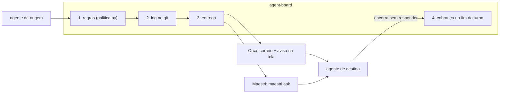

# Como funciona

> **Em 1 minuto:** o agent-board é um **carteiro com regras**. Ele não tem correio próprio: usa o do Orca ou o do Maestri. O que ele acrescenta é conferir cada mensagem, registrar no log do projeto, entregar pelo transporte certo e cobrar a resposta.

## As camadas

Uma mensagem sai de um agente, passa pelas quatro tarefas do agent-board e chega ao destino por um dos dois transportes.

1. **Regras:** quem envia (provado pelo ID do painel), para quem, com que tipo. Se falhar, a mensagem é barrada com o motivo e a correção.
2. **Log:** a linha vai para `docs/agent-board/comunicacoes.jsonl` antes da entrega. Se a entrega falha, uma linha `falhou` tira a mensagem da cobrança.
3. **Entrega:** pelo transporte do destino. No Orca, o hook também digita um aviso na tela de quem recebe.
4. **Cobrança:** quando o destino tenta encerrar o turno com mensagem sem resposta, o hook segura (até 3 vezes).

## Um pedido do começo ao fim

O diagrama mostra um pedido do master que o manager divide com um researcher. O `andamento` avisa que o trabalho segue; só a `resposta` fecha o pedido.

```mermaid
sequenceDiagram
  participant M as app-master
  participant B as agent-board
  participant G as app-manager01-cc
  participant R as app-researcher01-cc
  M->>B: pedido c-1 modo executar
  B->>G: confere, grava no log, entrega
  G->>B: andamento c-2 responde a c-1
  B->>M: entrega o progresso
  G->>B: pedido c-3 para o researcher
  B->>R: entrega
  R->>B: resposta c-4 responde a c-3
  B->>G: entrega e fecha c-3
  G->>B: resposta c-5 responde a c-1
  B->>M: entrega e fecha c-1
```

Cada seta que passa por `agent-board` vira uma linha no log. Se o master tentar responder a `c-5`, é barrado: resposta não se responde.

## Os dois transportes

O time inteiro fica num transporte só. Time misto (parte no Orca, parte no Maestri) não é suportado.

| | Orca | Maestri |
|---|---|---|
| Identidade do painel | `$ORCA_TERMINAL_HANDLE` (`term_…`) | `maestri:<$MAESTRI_TERMINAL_ID>` |
| Como o agente envia | `orca orchestration send` ou `board_send` | `board.py send` ou `board_send` |
| Como chega | correio do Orca + aviso de uma linha na tela | mensagem inteira digitada no terminal (`maestri ask`) |
| Quem fala com quem | qualquer painel | só terminais ligados por **corda** (ligação no canvas) |
| Cadastro | o master lista os painéis (`painel.py listar`) | o agente pede (`painel.py solicitar`), o master confirma |

Passo a passo de cada um: [guia do Orca](../guias/orca/README.md) e [guia do Maestri](../guias/maestri/README.md). A decisão está na [ADR-0006](../adr/0006-maestri-como-transporte.md).

## Quem aplica as regras

As regras moram num lugar só, `scripts/politica.py`. Três caminhos chegam até elas.

| Caminho do envio | Quem confere | Observação |
|---|---|---|
| `orca orchestration send` no shell | o **hook** (trava automática do harness) no `PreToolUse` | Vale no Claude Code e no OMP |
| `board.py send` | `envio.py` chama o mesmo `hook_core.decide()` antes e depois de entregar | O hook do shell só barra subagent |
| `board_send` (MCP) | `envio.py`, igual ao `board.py` | O hook do MCP só barra subagent ([ADR-0004](../adr/0004-servidor-mcp-reusa-a-politica-do-hook.md)). Como usar: [Guia do MCP](../guias/mcp.md) |

O que **só o hook** faz: barrar os desvios (`maestri ask` direto, `SendMessage`, escrita à mão no log), digitar o aviso no Orca e cobrar a resposta no fim do turno.

Por isso um agente que não é Claude Code nem OMP (Codex, Hermes, OpenCode…) só tem as regras **no envio**. Se ele usar `board.py send`, a mensagem é conferida e registrada. Mas nada o impede de pular o agent-board, e ninguém o cobra no fim do turno. Ele segue o [contrato](../../templates/CONTRATO.md) por disciplina.

No OMP, o adaptador `omp-agent-board.ts` só repassa ao hook os comandos do `orca`, do `maestri ask` e os que tocam o log ou o cadastro. A trava de subagent no `board.py` vale só no Claude Code.

## Leia também

- [Papéis e mensagens](papeis-e-mensagens.md): quem pode o quê e o ciclo de um pedido.
- [Regras](regras.md): o que é garantido e as regras opcionais.
- [Hooks e limites](../referencia/hooks-e-limites.md): a lista completa do que é barrado.
