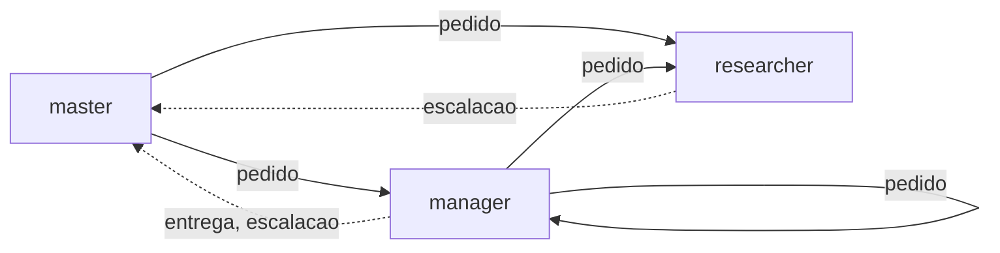
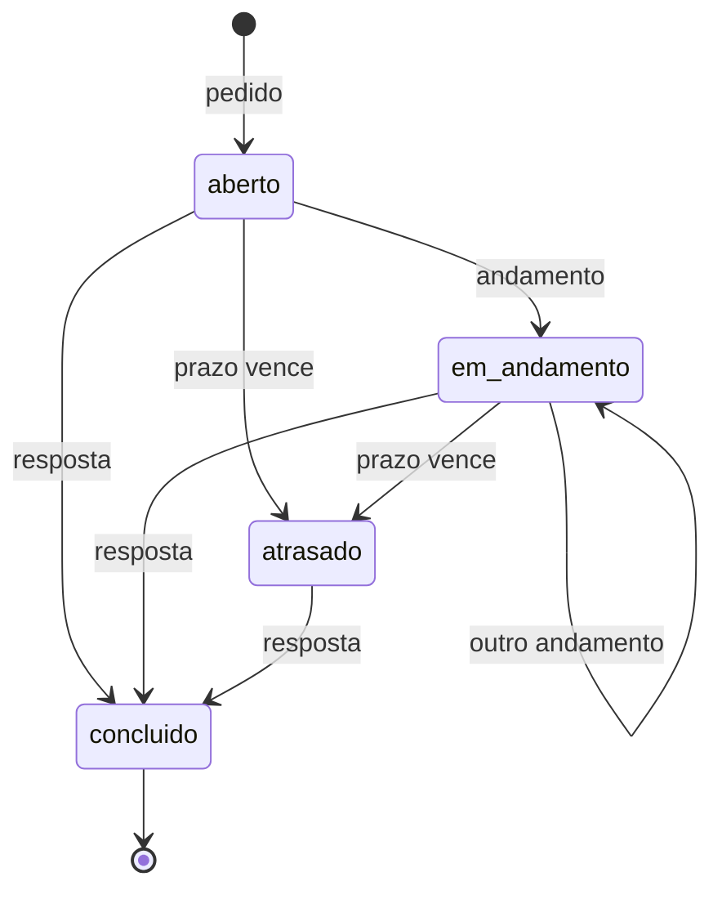
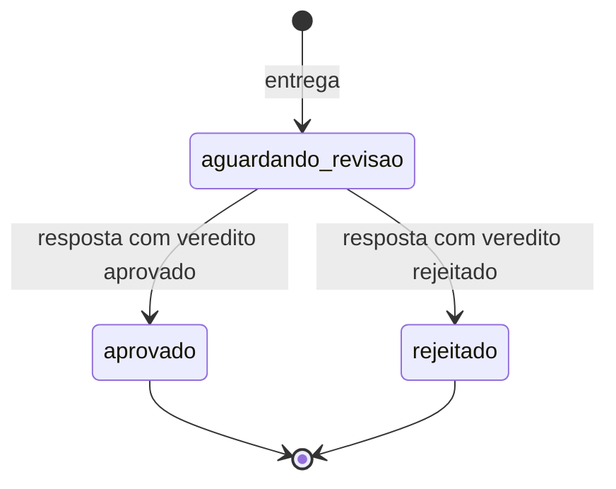

# Papéis e mensagens

> **Em 1 minuto:** o time tem três papéis (master, manager, researcher) e seis tipos de mensagem. O papel diz quais tipos você pode mandar e a quem pode pedir trabalho. Todo pedido e toda entrega têm um estado, calculado a partir do log.

## Os três papéis

| Papel | O que faz | Pode enviar (padrão) |
|---|---|---|
| **master** | Coordena, revisa entregas, faz merge e deploy. Único que fala com o humano e cadastra os painéis | `pedido`, `resposta`, `aviso` |
| **manager** (o developer) | Implementa na própria branch ou worktree e entrega ao master | todos os tipos |
| **researcher** | Só lê: pesquisa, análise e documentação | `resposta`, `aviso`, `escalacao`, `andamento` |

`andamento` vale para qualquer papel, mesmo fora da lista: é uma forma de resposta. Os papéis ficam em `docs/agent-board/agent-board.json` e podem mudar por projeto ([config](../referencia/config.md)).

Com os papéis padrão, os pedidos de trabalho e os retornos ao master andam assim:

O researcher não pede trabalho a ninguém. `entrega` e `escalacao` só vão para o master.

## Os seis tipos de mensagem

| Tipo | Para quê | Exige |
|---|---|---|
| `pedido` | Pedir um trabalho | `--modo` quando vai para manager. `--prazo` opcional |
| `resposta` | Devolver um pedido ou responder um aviso. Fecha a conversa | `--responde-a <id>[,<id>…]`. `--veredito` se responde a uma `entrega` |
| `aviso` | Informar sem pedir trabalho | Uma resposta curta de quem recebe |
| `escalacao` | Algo travou ou precisa de decisão | Vai só para o master |
| `entrega` | Trabalho pronto para revisão ou merge | Vai só para o master |
| `andamento` | Progresso de um pedido longo que você recebeu | `--responde-a <id do pedido>`, e vai para quem pediu |

Resposta e andamento **não se respondem**. Se ficou algo pendente, abra um `pedido` ou `aviso` novo.

## O ciclo de um pedido

O estado aparece em `painel.py tarefas` e no painel web. Ele é sempre derivado do log, nunca guardado à parte.

- `atrasado` só existe em pedido com prazo (`--prazo` ou `prazo_padrao`).
- `painel.py vigiar` avisa o master dos atrasados, uma vez por pedido.

## O ciclo de uma entrega

A entrega termina sempre com um veredito do master.

Rejeitou? Diga no corpo da resposta o que falta.

## Os modos de um pedido a manager

| Modo | O manager… |
|---|---|
| `executar` | faz o trabalho ele mesmo |
| `orquestrar` | trabalha com subagents, com revisão e QA (skill `/orchestrator`) |

Subagent não fala com outros agentes: só a sessão principal do manager envia mensagens.

## Nomes

| Papel | Nome | Exemplo |
|---|---|---|
| master (único) | `<prefixo>-master` | `app-master` |
| manager | `<prefixo>-manager<NN>-<runtime>` | `app-manager01-cc` |
| researcher | `<prefixo>-researcher<NN>-<runtime>` | `app-researcher01-cc` |

- `<prefixo>`: só letras minúsculas e números. `<NN>`: dois dígitos.
- Códigos de runtime: `cc` Claude Code, `omp` Oh My Pi, `cx` Codex, `agy` Antigravity, `oc` OpenCode, `hr` Hermes.
- Nome curto vale: `manager01-cc` vira `app-manager01-cc`.
- `--to papel:researcher` escolhe o researcher com menos pedidos abertos (empate: ordem alfabética), sem contar você.
- O nome é só endereço. Quem prova a identidade é o ID do painel, cadastrado pelo master.

**Próximo:** [Regras](regras.md)
