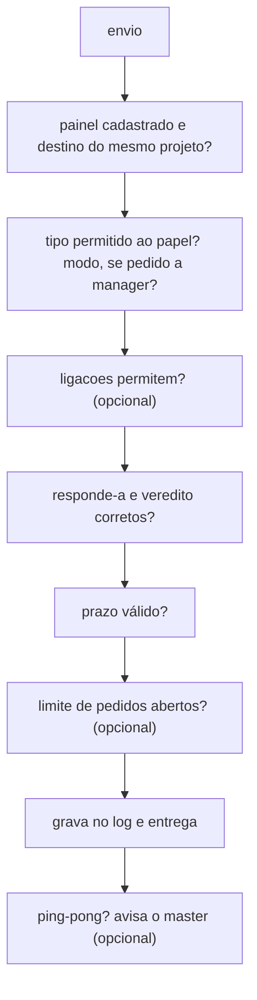

# Regras

> **Em 1 minuto:** seis regras valem sempre e protegem o time de mensagens perdidas, remetentes falsos e conversas sem fim. Outras quatro são opcionais: só valem quando a chave aparece no `agent-board.json`, e você pode testá-las contra o log real antes de ligar.

## O que vale sempre

| Regra | O que acontece | Por quê |
|---|---|---|
| **Um canal só** | `maestri ask` direto, `SendMessage` nativo e `orca orchestration reply`/`ask` entre agentes do time são barrados | Fora do agent-board a mensagem fica sem log, sem regra e sem cobrança |
| **Remetente provado** | O remetente é o ID do painel no cadastro, não o nome da sessão. Painel sem cadastro não fala com o time | Ninguém se passa por outro agente |
| **Resposta obrigatória** | O agente não encerra o turno com mensagem recebida sem resposta. O hook segura até 3 vezes e mostra o comando pronto | Pedido não se perde em silêncio |
| **Sem resposta a resposta** | `resposta` e `andamento` não se respondem | Evita a cadeia de "recebido" / "ok" |
| **Projetos isolados** | Um agente só fala com cadastrados do mesmo projeto | Times de projetos diferentes não se misturam |
| **Subagent não fala** | No Claude Code, subagent é barrado no `orca`, no `board.py` e no `board_send` | Só quem tem o contexto do pedido responde por ele |

Duas proteções completam essas regras:

- **Log e cadastro não se editam à mão.** O hook barra `>>`, `sed -i`, `rm`, Edit/Write e afins em `comunicacoes.jsonl` e `paineis.json`. Ler é livre.
- **Adulteração fica visível.** Cada linha do log leva o hash da anterior. `painel.py verificar` acusa linha editada ou apagada no meio ([ADR-0002](../adr/0002-cadeia-de-hash-no-log.md)).

A cobrança só conta o que o agente recebeu depois do cadastro atual do painel dele. Um recadastro recomeça a conta.

Regras do contrato que nenhum hook confere: pedido sem resposta em 15 minutos vira `escalacao` ao master. Comando travado por mais de ~5 min é interrompido e escalado. Nada de mensagem de cortesia.

## A ordem das checagens

Toda mensagem passa pelas mesmas checagens, nesta ordem. A primeira que falhar barra o envio.



## Regras opcionais

Cada uma só vale quando a chave existe. Sem ela, nada muda.

| Chave | Efeito | Barra? |
|---|---|---|
| `prazo_padrao` | Prazo de todo `pedido` sem `--prazo` (ex.: `"1d"`) | Não |
| `limites.pedidos_abertos_max` | Novo `pedido` a quem já tem esse número de pedidos sem resposta | Sim |
| `limites.ping_pong_max` + `ping_pong_janela_min` | Mais mensagens que o limite entre o mesmo par na janela, sem `entrega` no meio | Não: avisa o master na tela, uma vez por par por janela |
| `ligacoes` | `pedido` e `aviso` só nos pares listados, com direção. Cada lado é um papel ou o nome de um agente | Sim |

`resposta`, `andamento`, `escalacao` e `entrega` ao master sempre passam pelas `ligacoes`. Quem é barrado recebe a lista de para quem pode mandar.

Exemplo: prazo de um dia, no máximo 3 pedidos abertos por agente, e o master sem falar direto com o researcher. Como `aviso` também passa pelas `ligacoes`, liste os dois sentidos.

```json
"prazo_padrao": "1d",
"limites": {"pedidos_abertos_max": 3, "ping_pong_max": 6, "ping_pong_janela_min": 30},
"ligacoes": [["master", "manager"], ["manager", "master"],
             ["manager", "researcher"], ["researcher", "manager"], ["manager", "manager"]]
```

## Testar antes de ligar

Grave a config nova num arquivo à parte e rode o `simular`. Ele reexecuta cada mensagem do log contra ela e lista o que seria barrado.

```bash
python3 $S/painel.py simular --raiz <projeto> --config novo.json
```

A coluna `config_atual` diz se a config de hoje também barraria (`passa` ou `barrada`). O comando sai com 1 se algo seria barrado. Ele não recheca o texto do `--prazo` nem os nomes e painéis.

Todas as chaves: [config](../referencia/config.md). Decisão: [ADR-0007](../adr/0007-protocolo-de-tarefas-e-regras-opcionais.md).

**Próximo:** [O que o hook barra](../referencia/hooks-e-limites.md)
