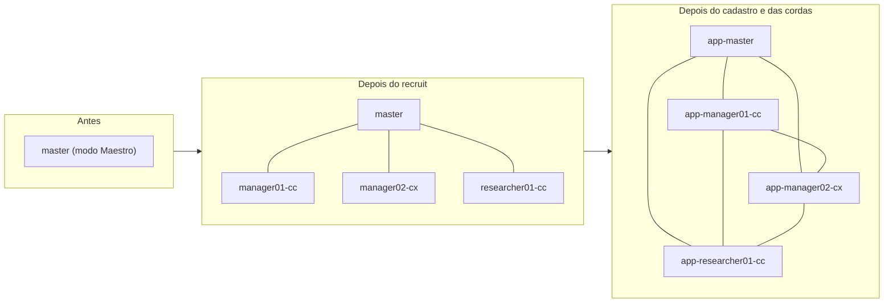

# 2. Montar o time (Maestri)

> **Em 1 minuto:** você parte de um terminal sozinho, o do master, e termina com o time recrutado, cadastrado e ligado por **cordas** (as ligações entre terminais no canvas). O cadastro começa no agente (`solicitar`) e termina no master (`cadastrar`), sempre com o "ok" do humano (o CEO).

**Antes:** [1. Instalar](1-instalar.md) feito e o terminal do master em modo Maestro. `S=~/.agents/skills/agent-board/scripts`.

O diagrama mostra o canvas em três momentos.



## Passo 1 — Recrutar os agentes
**Antes de recrutar (MCP, Claude Code):** o projeto precisa enxergar o servidor `agent-board`. Ou o `install.sh` já o registrou para o usuário (confira com `claude mcp list`), ou você põe um `.mcp.json` na raiz do projeto (use o caminho **absoluto** da skill; detalhes no [guia do MCP](../mcp.md)):
```json
{"mcpServers": {"agent-board": {"command": "python3", "args": ["<caminho absoluto>/.agents/skills/agent-board/scripts/mcp_server.py"]}}}
```
Libere as chamadas em `<projeto>/.claude/settings.json`, para não pedir aprovação a cada uma:
```json
{"permissions": {"allow": ["mcp__agent-board"]}}
```
No terminal do master, veja os presets e recrute cada agente com o nome do time. O recrutado já nasce com corda até você.
```bash
maestri preset list
maestri recruit "app-manager01-cc" --preset "Claude Code" --dir <projeto>
maestri recruit "app-manager02-cx" --preset "Codex" --dir <projeto>
maestri recruit "app-researcher01-cc" --preset "Claude Code" --dir <projeto>
```
Nomes: `<prefixo>-master`, `<prefixo>-manager<NN>-<runtime>`, `<prefixo>-researcher<NN>-<runtime>`. Runtime: `cc` Claude Code, `cx` Codex, `oc` OpenCode, `omp` Oh My Pi, `agy` Antigravity, `hr` Hermes. Dê ao seu terminal o nome `app-master` no canvas, se quiser.

> **MCP:** cada agente Claude Code novo, ao abrir num projeto com `.mcp.json`, mostra "New MCP server found in this project: agent-board". Escolha **"Use this MCP server"** (a primeira; a seleção inicial é a última, "Continue without using this MCP server"). Quem recruta aceita por ele, antes de o agente ser cadastrado:
> ```bash
> maestri ask "app-manager01-cc" --raw '\e[A\e[A\n'
> ```
> (duas setas para cima e Enter). Depois de cadastrado, só o master usa `--raw` em agente do time.

✅ **Deu certo se:** `maestri list` mostra os três em "Connected agents".

## Passo 2 — Criar os arquivos do projeto
```bash
python3 $S/painel.py init --raiz <projeto> --projeto <nome> --prefixo app
```
Cria `docs/agent-board/` (config, `CONTRATO.md`, log vazio). Não sobrescreve o que existe. Faça o commit numa branch.

✅ **Deu certo se:** aparecem linhas `criado …/agent-board.json`, `…/CONTRATO.md` e `…/comunicacoes.jsonl`.

## Passo 3 — Cada terminal pede o próprio cadastro
O master pede o dele e pede aos outros com um `maestri ask` comum. Pode, porque eles ainda não são do time.
```bash
python3 $S/painel.py solicitar --raiz <projeto> --agente app-master
maestri ask "app-manager01-cc" "Rode: python3 ~/.agents/skills/agent-board/scripts/painel.py solicitar --raiz <projeto> --agente app-manager01-cc"
```
Repita o `ask` para cada agente. Use sempre a raiz do checkout principal.

✅ **Deu certo se:** cada um imprime `pedido de cadastro registrado: maestri:<id> (<nome>) como <agente>`.

## Passo 4 — Ver os pedidos e confirmar com o humano
```bash
python3 $S/painel.py solicitacoes
```
A saída lista ID, nome no canvas e o nome pedido, e sugere a linha do `cadastrar`. **Mostre a lista ao humano e espere o "ok".** Nunca cadastre por dedução.

✅ **Deu certo se:** cada terminal aparece uma vez, com o nome certo.

## Passo 5 — Cadastrar
```bash
python3 $S/painel.py cadastrar --raiz <projeto> maestri:<id1>=app-master maestri:<id2>=app-manager01-cc ...
```
✅ **Deu certo se:** uma linha `cadastrado maestri:<id> = <projeto>/<agente>` por terminal.

## Passo 6 — Ligar as cordas que as regras exigem
Primeiro veja; com o "ok" do humano, aplique (precisa do modo Maestro).
```bash
python3 $S/painel.py maestri conectar --raiz <projeto>
python3 $S/painel.py maestri conectar --raiz <projeto> --aplicar
```
O master liga com todos. Os outros pares saem de `ligacoes` ou, sem ela, de `pode_pedir_a` ([Config](../../referencia/config.md)).

✅ **Deu certo se:** sem `--aplicar`, uma linha `maestri connect …` por par; com `--aplicar`, `ok   A <-> B` em todas.

## Passo 7 — Mandar a mensagem de virada
Para cada agente, pelo `board.py`. A resposta confirma que leu.
```bash
python3 $S/board.py send --to manager01-cc --type aviso --subject 'Novo canal entre agentes' --body 'A partir de agora, fale com o time só por board.py send, conforme docs/agent-board/CONTRATO.md. maestri ask direto com agente do time é barrado. Leia o contrato e responda com --type resposta.'
```
✅ **Deu certo se:** a saída diz `c-… enviada para manager01-cc (aviso)` e a resposta chega digitada no seu terminal.

## Vários managers, vários harnesses
- Pode haver vários managers (developers) e researchers, cada um com seu número: `manager01`, `manager02`…
- Pode misturar harnesses: um manager Codex (`-cx`) ao lado de managers Claude Code (`-cc`).
- Em agente que não é Claude Code (nem OMP), as regras valem do mesmo jeito no envio, porque o `board.py` as confere sozinho. Mas sem hook não há trava de `maestri ask` direto nem cobrança de resposta no fim do turno. Para ele, vale o contrato.

## Se der errado
| Você vê | Faça |
|---|---|
| "This terminal is not the Maestro" | Ligue o modo Maestro no terminal do master ([passo 5 da instalação](1-instalar.md)) |
| "não tem docs/agent-board/agent-board.json; rode painel.py init antes" | Faça o passo 2 e use a mesma `--raiz` |
| "maestri:<id> não pediu cadastro" | Esse terminal não rodou o `solicitar`. Volte ao passo 3 |
| "nome fora do padrão" | Corrija o nome: prefixo, papel, dois dígitos e runtime |
| `FALHA A <-> B` no `conectar` | Confira o nome no canvas com `maestri list` e o modo Maestro |
| "nenhuma corda a criar" | Ninguém do projeto está cadastrado ainda. Faça o passo 5 |

Mais casos: [4. Problemas](4-problemas.md). Por que o cadastro começa no agente: [ADR-0006](../../adr/0006-maestri-como-transporte.md).

**Próximo:** [3. Dia a dia](3-dia-a-dia.md)
