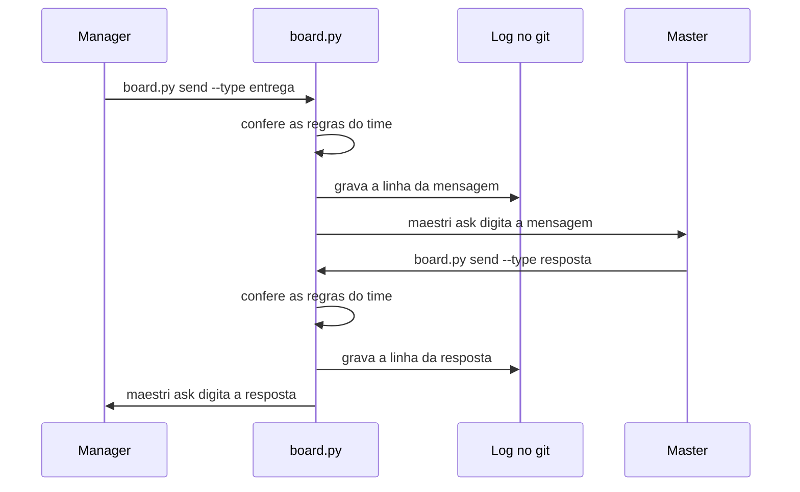

# Guia do Maestri

> **Em 1 minuto:** no [Maestri](https://www.themaestri.app/pt-br/docs/intro), cada agente é um **terminal** num canvas. Terminais ligados por uma **corda** (a ligação entre dois terminais no canvas) se falam com `maestri ask`, que digita o texto no terminal do outro. O agent-board põe regras, log e cobrança de resposta em cima disso: o time fala só por `board.py send`.

Usa o Orca? Siga o [guia do Orca](../orca/README.md). Quer enviar por ferramentas em vez do shell (Claude Code)? Veja o [guia do MCP](../mcp.md).

## Os 4 passos

1. [Instalar](1-instalar.md): skill e hooks na máquina onde o Maestri roda os terminais, e o modo Maestro.
2. [Montar o time](2-montar-o-time.md): de um terminal sozinho (o master) até o time cadastrado e ligado por cordas.
3. [Dia a dia](3-dia-a-dia.md): enviar, receber, entregar, acompanhar tarefas, notas, floors e o painel web.
4. [Problemas](4-problemas.md): o que fazer quando algo não chega ou é barrado, e a manutenção do time.

## Como uma mensagem anda no Maestri

O diagrama mostra um manager entregando ao master e a resposta voltando.

O `maestri ask` roda em segundo plano: quem envia não fica esperando o outro terminar. Se ele falhar nos primeiros 3 s (sem corda, nome errado), o envio sai como **NÃO entregue** e o log marca `falhou`.

## Para entender melhor

- [Como funciona](../../conceitos/como-funciona.md) · [Papéis e mensagens](../../conceitos/papeis-e-mensagens.md) · [Regras](../../conceitos/regras.md)
- [Comandos](../../referencia/comandos.md) · [Hooks e limites](../../referencia/hooks-e-limites.md)
- Por que o Maestri funciona assim: [ADR-0006](../../adr/0006-maestri-como-transporte.md)
