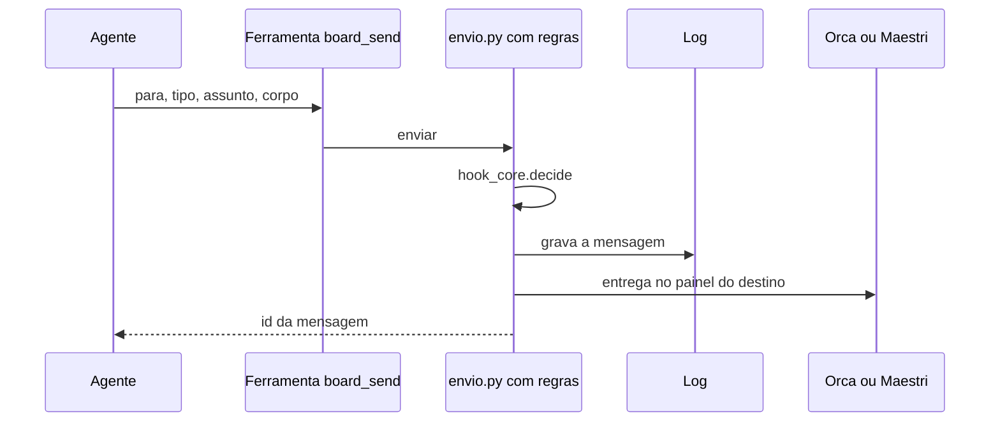

# Mensagens por ferramentas (MCP)

> **Em 1 minuto:** você registra o servidor `agent-board` no Claude Code e os agentes passam a mandar mensagens com ferramentas tipadas (`board_send` e outras 4), sem montar comando no shell. Vale para Orca e Maestri; as regras são as mesmas do `board.py`.

**Antes:** time montado ([Orca](orca/2-montar-o-time.md) ou [Maestri](maestri/2-montar-o-time.md)) e agent-board instalado ([Orca](orca/1-instalar.md)).

## O que acontece numa chamada

A ferramenta chama o mesmo `envio.py` do `board.py`: as regras decidem, o log grava e o transporte do destino entrega.



O servidor é `scripts/mcp_server.py` (JSON-RPC 2.0 sobre stdio, só biblioteca padrão). O corpo é **texto puro**: crase e `$( )` chegam como texto, porque nunca passam por shell. Fim dos erros de aspas.

## Passo 1 — Registrar o servidor

O `install.sh` já faz isso sozinho se o `claude` estiver no PATH (repete sem problema; se havia outro caminho, troca). Manualmente:

```bash
S=~/.agents/skills/agent-board/scripts
claude mcp add --scope user agent-board -- python3 $S/mcp_server.py
```

Só para um projeto: crie `.mcp.json` na raiz dele, com caminho absoluto.

```json
{"mcpServers": {"agent-board": {"command": "python3",
  "args": ["<caminho absoluto>/scripts/mcp_server.py"]}}}
```

Se o estado do agent-board não está no padrão, acrescente `"env": {"AGENT_BOARD_HOME": "<caminho>"}` ao lado de `args` ([config](../referencia/config.md)).

✅ **Deu certo se:** `claude mcp get agent-board` mostra o servidor.

## Passo 2 — Aprovar e liberar

Num projeto com `.mcp.json`, o Claude Code pergunta "New MCP server found in this project: agent-board". A seleção inicial é a **última** opção; escolha a primeira, **Use this MCP server**. Para refazer a escolha: `claude mcp reset-project-choices`.

Cada chamada de ferramenta MCP também pede aprovação. Para liberar as 5 de uma vez, no `settings.json`:

```json
{"permissions": {"allow": ["mcp__agent-board"]}}
```

✅ **Deu certo se:** `claude mcp list` mostra `agent-board` conectado e o agente enxerga `mcp__agent-board__board_send`.

## Passo 3 — Conferir quem é o agente

Peça ao agente para chamar `board_status`. O servidor sabe quem ele é pelo ambiente do terminal: `$MAESTRI_TERMINAL_ID` (Maestri) ou `$ORCA_TERMINAL_HANDLE` (Orca).

✅ **Deu certo se:** volta algo como `agente: abt-manager01-cc, papel: manager, handle: maestri:<id>, pendentes: 0`, além de projeto, raiz e lista de agentes.

## Passo 4 — Usar

| Ferramenta | Exemplo |
|---|---|
| `board_send` | `board_send(para="manager01-cc", tipo="pedido", modo="executar", assunto="…", corpo="…")` |
| `board_inbox` | `board_inbox()` lê o correio do seu painel |
| `board_pendentes` | `board_pendentes()` lista o que você recebeu e não respondeu |
| `board_historico` | `board_historico(agente="master", sobre="login", n=10)` |
| `board_status` | `board_status()` mostra quem você é |

Para responder, use `board_send(para=…, tipo="resposta", responde_a="<id do pedido>", assunto="…")`. Resposta a uma entrega leva `veredito="aprovado"` ou `"rejeitado"`. Campos opcionais do `board_send`: `issues`, `prazo` (ex.: `2h`). Regras de papéis e tipos: [regras](../conceitos/regras.md).

✅ **Deu certo se:** `board_send` devolve um id `c-AAAAMMDD-…`. Num teste ao vivo no Maestri, um manager respondeu a um pedido só com `board_send`: o log gravou a resposta e o pedido foi para `concluido`.

## Orca × Maestri

| | Orca | Maestri |
|---|---|---|
| `board_inbox` | roda `orca orchestration check --terminal <painel> --format` | as mensagens já chegam digitadas no terminal; devolve as pendentes (como `board_pendentes`) |
| Identidade | `$ORCA_TERMINAL_HANDLE` (só testado em código e testes, não ao vivo) | `$MAESTRI_TERMINAL_ID` (testado com Claude Code real) |

## MCP ou shell?

| Situação | Use |
|---|---|
| Texto longo, aspas, crase | MCP |
| Codex, OpenCode, OMP | `board.py` ou `orca` no shell |

Só o Claude Code foi testado com o MCP. Em Codex, OpenCode e OMP **não testamos**; o caminho garantido é o shell ([comandos](../referencia/comandos.md)).

## Segurança

Ferramenta MCP não passa pelo hook das regras, então o `envio.py` aplica as regras sozinho. O `install.sh` liga só o matcher `mcp__agent-board__board_send` para **barrar subagent**, que não fala com o time ([hooks e limites](../referencia/hooks-e-limites.md), [ADR 0004](../adr/0004-servidor-mcp-reusa-a-politica-do-hook.md)).

## Se der errado

| Você vê | Faça |
|---|---|
| "este painel … não está cadastrado no agent-board" | Peça ao master para cadastrar o painel com `painel.py cadastrar` |
| Servidor não aparece em `claude mcp list` | Rode o Passo 1; no `.mcp.json`, confira o caminho absoluto e reabra a sessão |
| Ferramentas ausentes no projeto com `.mcp.json` | Você escolheu "Continue without using this MCP server": `claude mcp reset-project-choices` e aprove |
| Pede aprovação a toda chamada | Adicione `mcp__agent-board` em `permissions.allow` |
| "Barrado … subagent não fala com outros agentes" | Devolva para a sessão principal enviar |
| Estado em outro lugar, nada no log | Defina `AGENT_BOARD_HOME` no `env` do `.mcp.json` |

**Próximo:** [como funciona](../conceitos/como-funciona.md) · [comandos (Ferramentas MCP)](../referencia/comandos.md) · [Orca](orca/README.md) · [Maestri](maestri/README.md)
