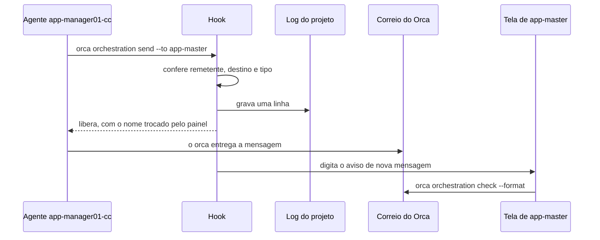

# Caminho Orca

> **Em 1 minuto:** no Orca, cada agente roda num **painel** (um terminal do Orca). O agent-board usa o correio do próprio Orca para levar mensagens entre painéis. Um **hook** (trava automática do Claude Code) confere cada envio, grava no log do projeto e avisa o destino na tela.

Usa o canvas do Maestri? Siga o [caminho Maestri](../maestri/).

Prefere ferramentas tipadas a comandos no shell? O agente também envia e lê pelo MCP (`board_send`, `board_inbox`...). Veja o [guia do MCP](../mcp.md).

## Os 4 passos

| Passo | O que você faz |
|---|---|
| [1. Instalar](1-instalar.md) | Coloca a skill numa pasta fixa e liga os hooks, uma vez por máquina |
| [2. Montar o time](2-montar-o-time.md) | Cria a config do projeto, cadastra os painéis e apresenta o time |
| [3. Dia a dia](3-dia-a-dia.md) | Envia, recebe, responde, entrega e acompanha |
| [4. Problemas](4-problemas.md) | Resolve bloqueios e faz a manutenção do time |

## O caminho de uma mensagem

O diagrama mostra o que acontece entre o envio e a leitura.

Se o hook barra o envio, nada é gravado nem entregue. O motivo e a correção aparecem na hora.

Para entender o porquê de cada etapa, leia [Como funciona](../../conceitos/como-funciona.md).
